# How to use IMS

IMS keeps track of **stock** (things you count, like gloves or cable ties) and **assets** (tagged equipment, like drills or laptops).
Works on a phone, tablet, or computer. Button names below are exactly what you see on screen. Pictures use sample data.

---

## 1. Sign in

1. Open the IMS link.
2. Type your **email** and **password** → **Sign in**.

Forgot your password? Ask your administrator for a **reset link**.

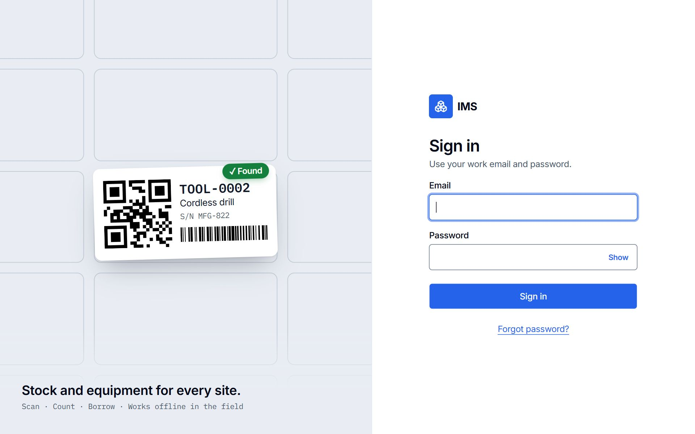

---

## 2. Who does what

| You are         | You can                                                                             |
| --------------- | ----------------------------------------------------------------------------------- |
| **Admin**       | Everything, plus users, locations, and settings                                     |
| **Supervisor**  | Receive, issue, move stock · borrow and return equipment · start and approve counts |
| **Field staff** | Count with your phone (works without internet) · send borrow requests               |

---

## 3. Office: everyday tasks

Start on the **Dashboard**. "Needs your action" at the top is your to-do list. Buttons at the top right: **Receive**, **Issue**, **Transfer**.

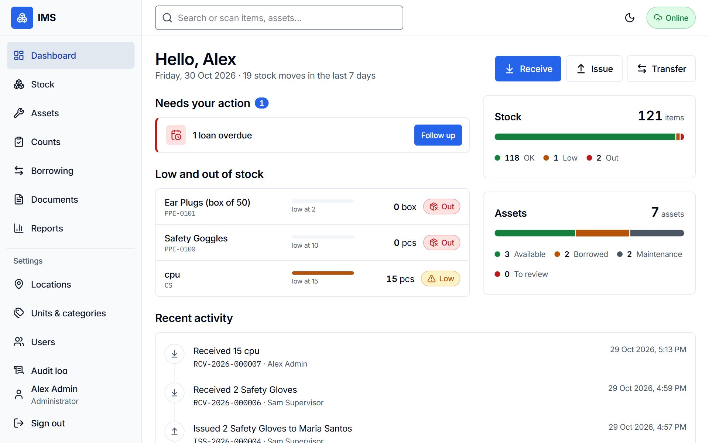

Every stock and borrow task has the same 4 steps: **Where → What → Who → Review**. Nothing changes until you press the **Confirm** button on the last step.

### Receive stock (new delivery)

**Dashboard** → **Receive** → pick the location → scan or search the items, type how many → who it came from → **Confirm receipt**.

### Give out stock (Issue)

**Dashboard** → **Issue** → pick the location → items and quantities → who gets it and why → **Confirm issue** → **Download PDF** or **Print** the form.

Step 2 (What): scan or type the item, press Enter, set how many.

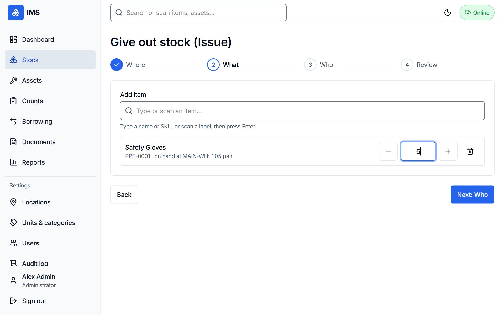

Step 4 (Review): check the numbers. It shows the stock before → after. Then **Confirm issue**.

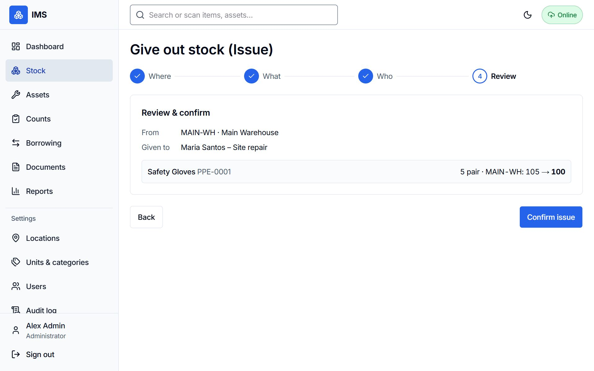

### Move stock between locations (Transfer)

**Dashboard** → **Transfer** → from and to → items and quantities → reason → **Confirm transfer**.

### Find anything

Type or scan in the **search box** at the top (name, SKU, asset tag, or barcode). Or open **Stock**: filter by category, or tap **Low** / **Out**.

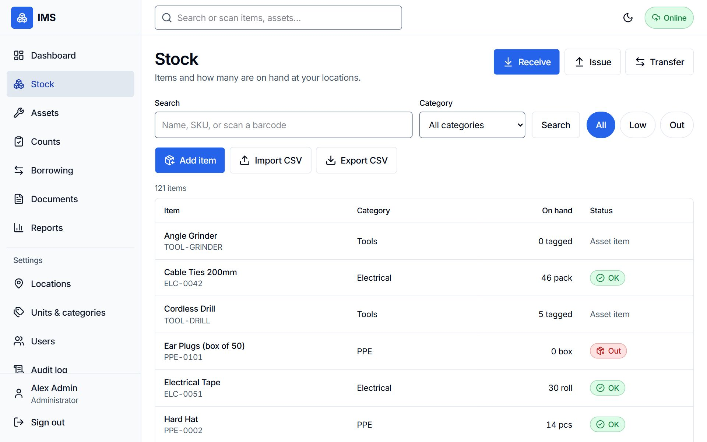

### Add items

- One item: **Stock** → **Add item**.
- Many items: **Stock** → **Import CSV** → choose the file → check the red rows → **Import … valid rows**.

### Add equipment and print labels

1. **Assets** → **Add assets** → pick the item, how many, location → save. Each unit gets its own tag.
2. **Print labels** → print on A4 label paper (3 × 8, 70 × 37 mm) at **100% scale**.

Each asset has its own page: status, who has it, and its full history.

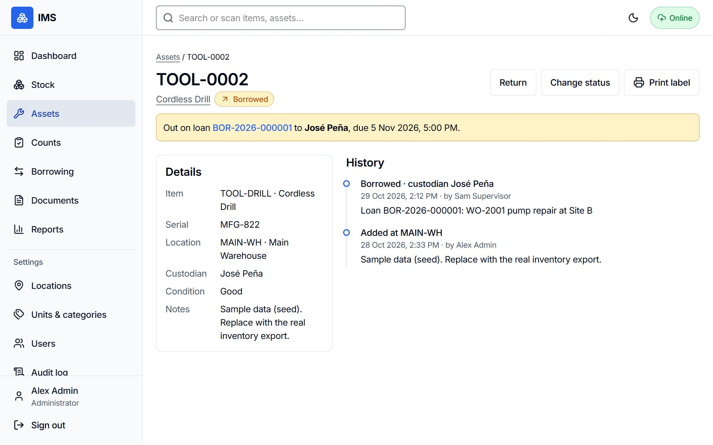

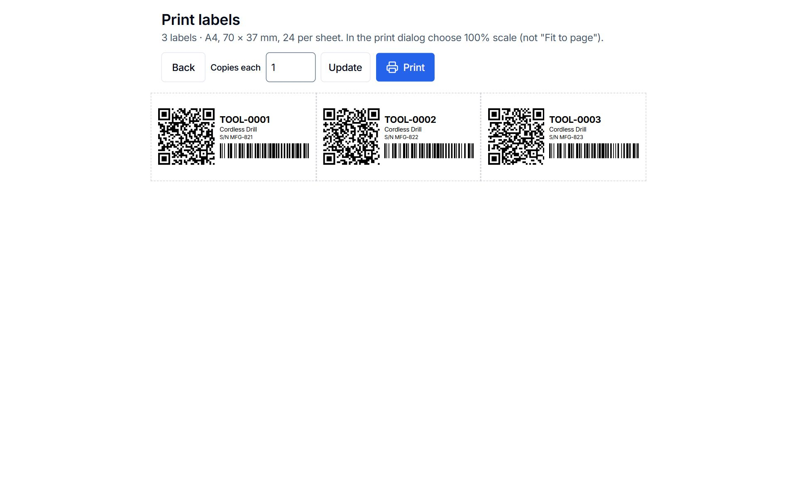

### Lend equipment

**Borrowing** → **Borrow equipment** → where it is → scan the asset tags → borrower, purpose, due date → **Confirm release** → print the **Equipment Borrowing form** for signing.

Tabs: **Requests** (from the field), **Out now**, **Overdue** (red), **Closed**.

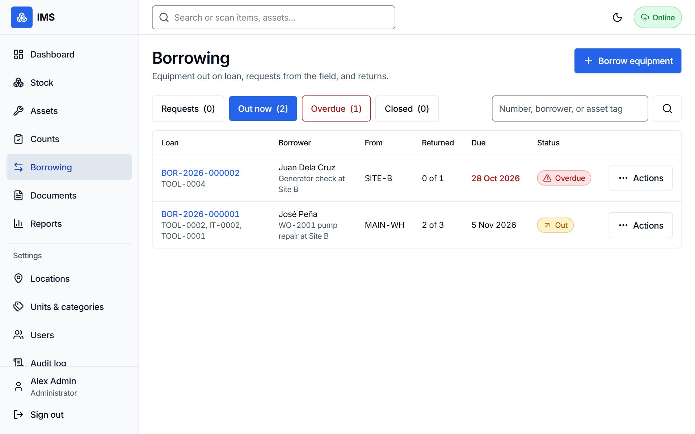

### Take equipment back

**Borrowing** → open the loan → tick each item that came back → set its condition → who brought it → **Return equipment** → **Confirm return**.
Damaged items go to **Needs review** or **Under maintenance** (you choose), not back to "Available". You can return some items now and the rest later.

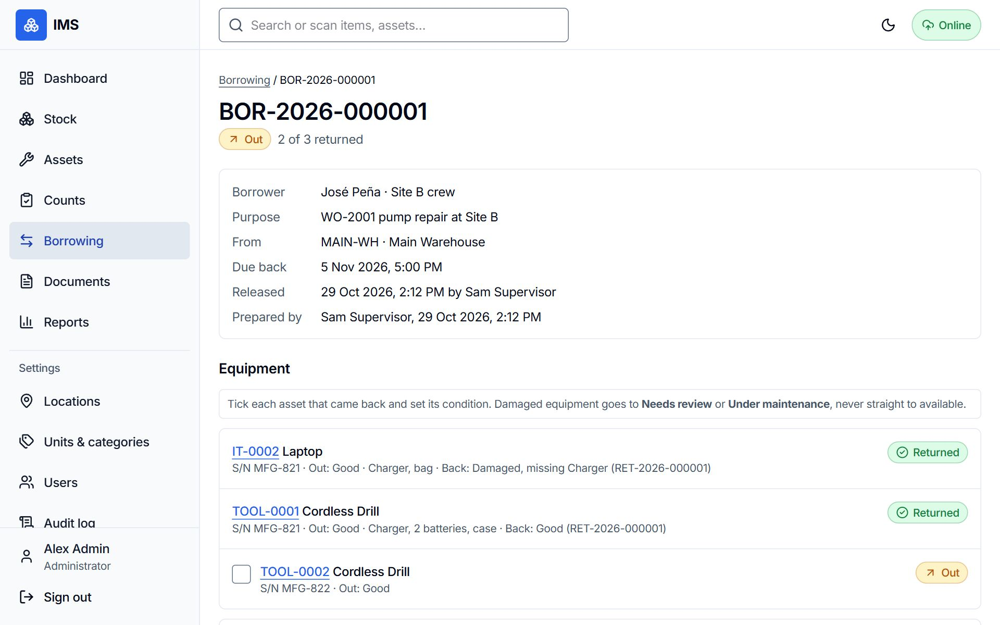

### Approve a borrow request from the field

**Borrowing** → **Requests** tab → open it → **Check and release**.

### Start a stock count

**Counts** → **New count** → location → which items → who counts → finish-by date → **Create count**.
Try not to move stock at that location while it's being counted.

### Review a count

**Counts** → open the count. For each line:

- **Approve**: fix the stock to the counted number.
- **Request recount**: ask the counter to count again.
- **Keep expected**: ignore the counted number.

**Approve all** approves every line that already matches. When done → **Close count**.
Stock only changes when you approve. Counting alone never changes stock.

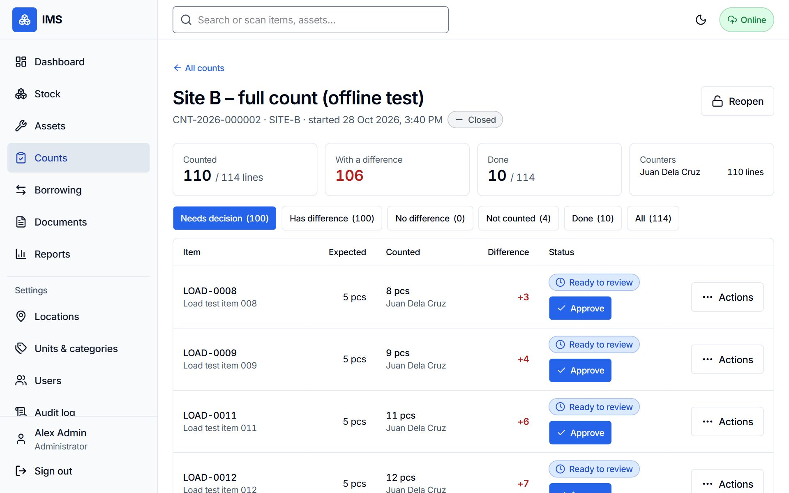

### Forms (PDFs)

**Documents** → search by number (e.g. `ISS-2026-000123`) → **View**, **Download PDF**, or **Print**.
If it says "PDF failed" → **Retry PDF**. The stock is already saved; retrying only remakes the form.

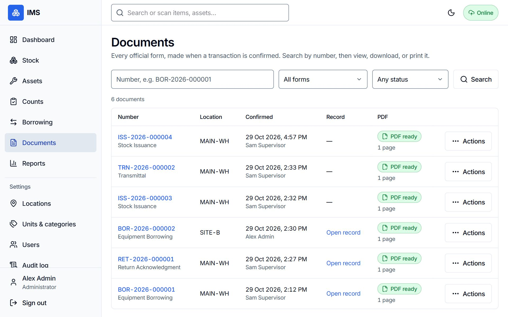

### Reports

**Reports** → pick a report → set filters → **Download CSV** (opens in Excel).

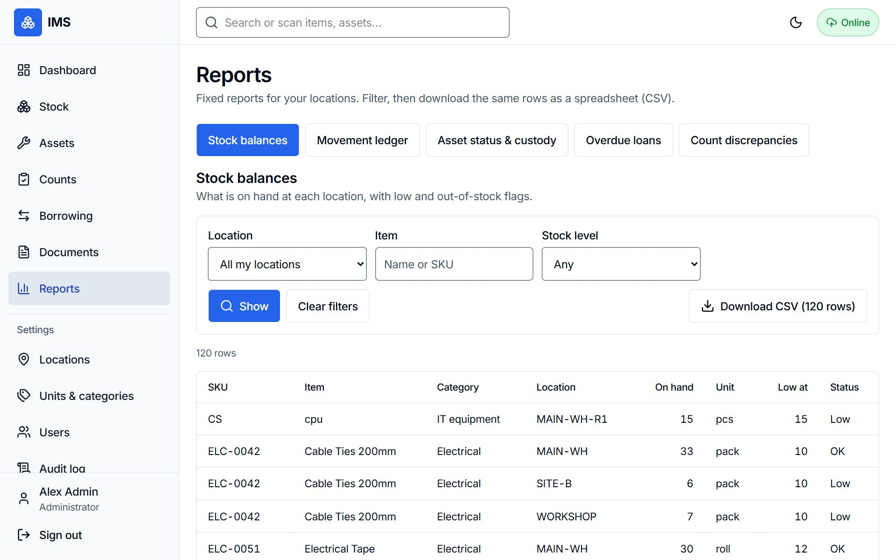

---

## 4. Field: counting with your phone

### First time (needs internet)

1. Open the IMS link on your phone and sign in.
2. **Me** → **Install IMS on this phone** → follow the steps (Android or iPhone).
3. Open IMS from the new icon on your home screen.

  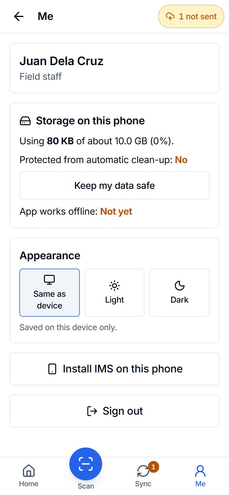

### Before you go (needs internet)

**Home** → your assignment → **Download for offline use**.
Wait for **✓ Ready for offline use**. Now it works without signal.

  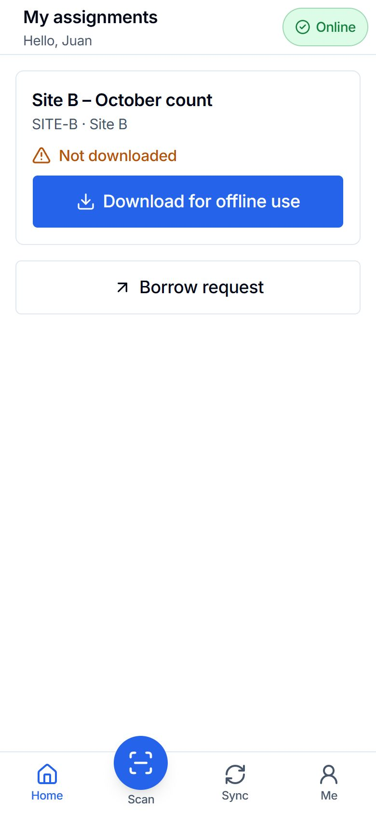
  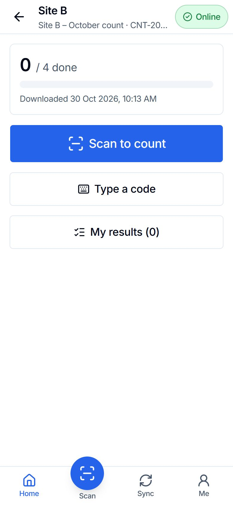

### Count

1. Open the assignment → **Scan to count**.
2. Point the camera at the label. Camera not working? → **Type a code**.
3. Then:
   - **Stock item:** type how many → **Save count**.
   - **Equipment:** tap **Found** or **Not found**, pick the condition → **Save check**.
4. Scan the next one.

Scanned the same thing twice? It opens your saved count. It does **not** add again.
To fix a count: **My results** → tap the line → change it.

  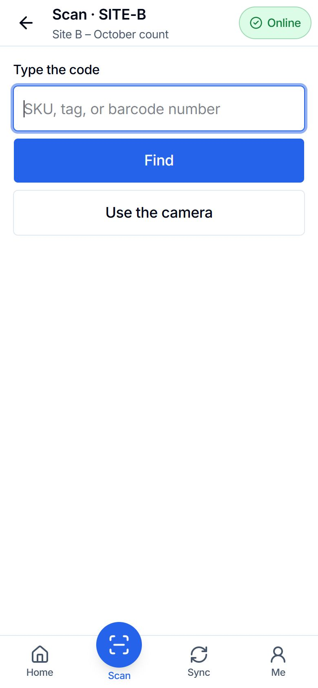
  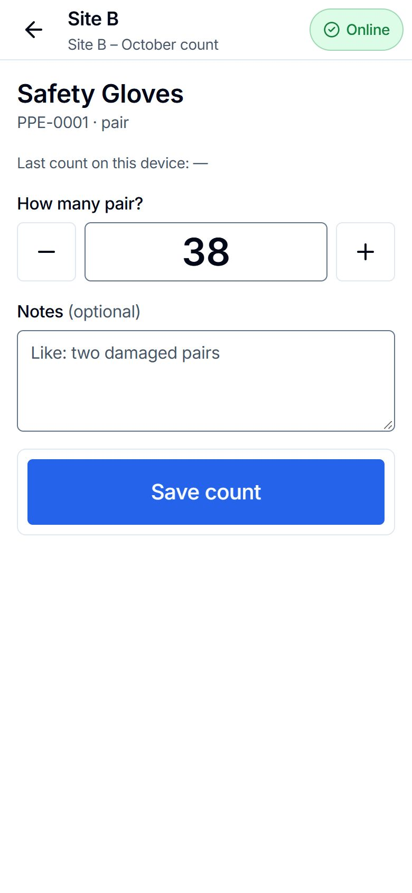

### Send your counts (needs internet)

**My results** → **Send counts**.
The pill at the top shows where they are: **"3 not sent"** = still on the phone. **"All sent"** = the office has them.
No signal? Counts stay safe on the phone. Send them later from **Sync** → **Sync now**.

  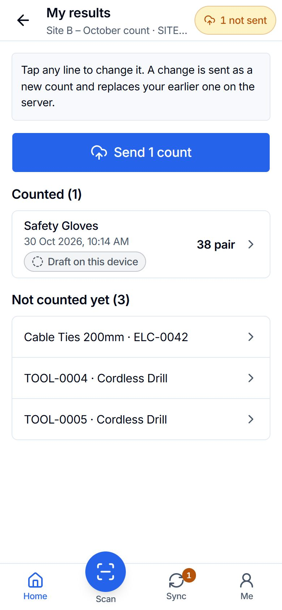
  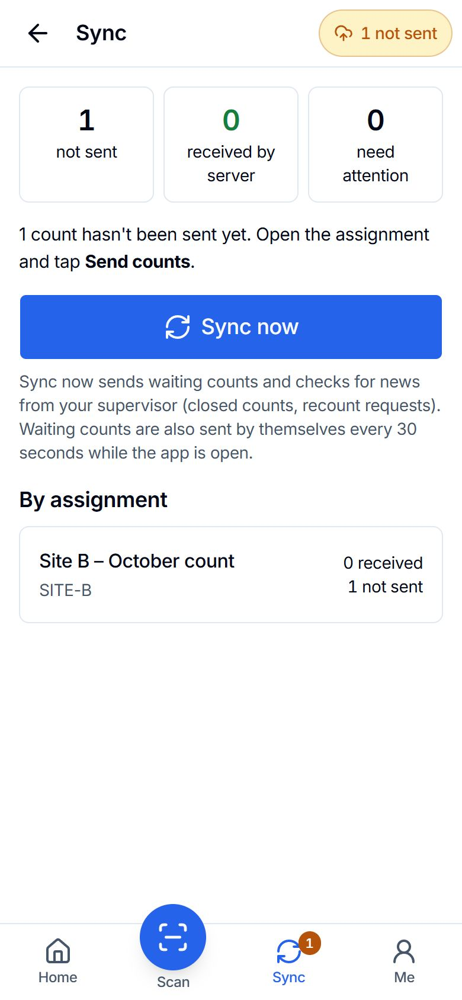

### Ask to borrow equipment

**Home** → **Borrow request** → scan the tags → **Send to supervisor**.
It's only a request. The supervisor does the official release.

  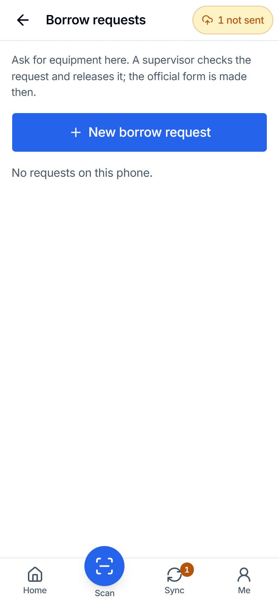

---

## 5. What the colors mean

| Color     | Means                                          |
| --------- | ---------------------------------------------- |
| 🟢 Green  | OK · Available · Done · All sent               |
| 🟠 Orange | Low stock · Borrowed · Not sent yet            |
| 🔴 Red    | Out of stock · Overdue · Problem, needs action |
| ⚪ Grey   | Inactive · Retired · Draft                     |

The **Dashboard** shows "Needs your action" first. Clear that list and your day is done.

---

## 6. Dark mode

Tap the **sun / moon** button at the top. Or **Me** → **Appearance** → **Same as device**, **Light**, or **Dark**.

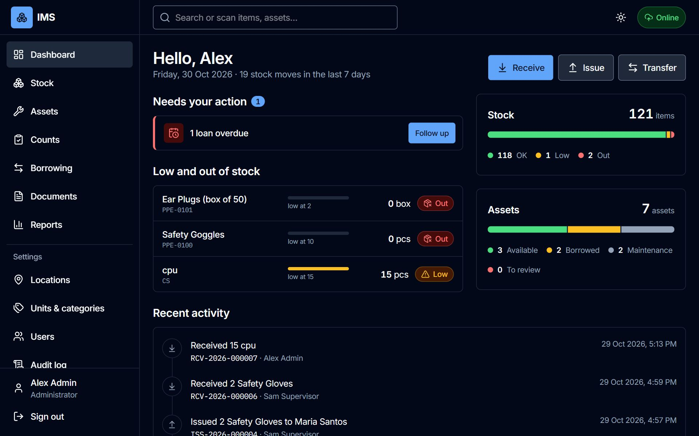

---

## 7. Problems

| Problem                    | Do this                                                                              |
| -------------------------- | ------------------------------------------------------------------------------------ |
| Camera won't open          | Allow camera for IMS in the phone settings, or use **Type a code**                   |
| "Not downloaded"           | Get internet, then **Download for offline use**                                      |
| Counts stuck on "not sent" | Get internet → **Sync** → **Sync now**                                               |
| "Only 3 left" when issuing | Lower the quantity or pick another location                                          |
| Asset can't be borrowed    | It's already borrowed, under maintenance, or retired. Check its status on **Assets** |
| Forgot password            | Ask the admin: **Users** → **Reset link**                                            |

## 8. Don't

- **Don't clear browser data or uninstall** while counts are not sent. Unsent counts would be lost.
- **Don't share your account.** Every action is recorded under your name.
- **Don't count without downloading first** if you'll be out of signal.

---

## 9. Admin only

- **Users** → **Add user** (give the temporary password to the person directly) · **Reset link** · deactivate.
- **Locations** → **Add location** (warehouse, site, rack).
- **Units & categories** → manage lists used by items.
- **Audit log** → who did what, and when.
