# How to use IMS

IMS (Inventory Management System) keeps the number of each item on hand at each location, like gloves, cable ties,
drills or laptops. Items come in with **Receive**, go out with **Issue**, and can be lent and brought back with
**Borrow** and **Return**: what is lent is taken out of stock until it comes back.

It works on a phone, tablet or computer. Words in **bold** are exactly what you see on screen. Pictures use sample data.

<!-- part: Getting started -->

## 1. Sign in

1. Open the IMS link your company gave you.
2. Type your **Email** and **Password**.
3. Press **Sign in**.

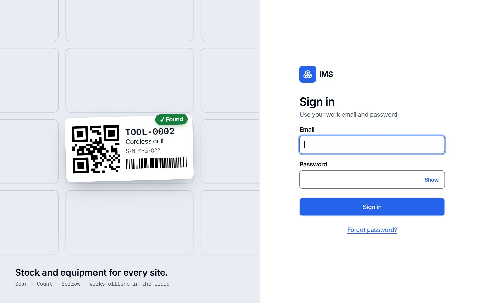

> **Forgot your password?** Ask an administrator. They open **Users**, choose **Reset link** on your name, and send you the link. Open it, type a new password twice (at least 10 characters), then press **Save new password**.

> **Warning:** 5 wrong passwords in 15 minutes lock your email for 15 minutes. An administrator's **Reset link** unlocks it straight away.

## 2. Who can do what

| You are           | You can                                                                                                                |
| ----------------- | ---------------------------------------------------------------------------------------------------------------------- |
| **Administrator** | Everything, at every location, plus **Users** and the **Audit log**                                                    |
| **Supervisor**    | At your locations: add items, receive, issue and transfer stock, lend items and take them back, run and approve counts |
| **Field staff**   | Count with your phone (works without internet) and send borrow requests                                                |

Field staff always land in the field app. If they open an office page, IMS sends them to the field app instead.

## 3. Finding your way

**On a computer**, the menu is on the left:

- **Dashboard**, **Stock**, **Borrowing**, **Counts**, **Documents**, **Reports**
- Under **Settings**: **Locations**, **Units & categories**, **Users**, **Audit log** (you only see what your role allows)
- At the bottom: your name (your **Me** page) and **Sign out**

**On a phone**, the bar at the bottom has **Dashboard**, **Stock**, **Scan**, **Borrowing** and **More** (everything else).

At the top of every page:

- **Search box**: type or scan a name, SKU or barcode.
- **Sun / moon button**: switches between light and dark.
- **Online** pill: green when IMS can reach the server.

### The dashboard

The **Dashboard** opens when you sign in.

- **Needs your action** is your to-do list: counts to review, borrow requests, overdue loans and failed forms. Clear it and your day is done.
- **Low and out of stock** shows what needs reordering.
- **Loans** shows how many loans are open and how many are overdue.
- **Recent activity** shows the latest stock moves, loans and returns, 10 at a time (use **‹ ›** to see older ones).
- **Receive**, **Issue** and **Transfer** buttons are at the top right.

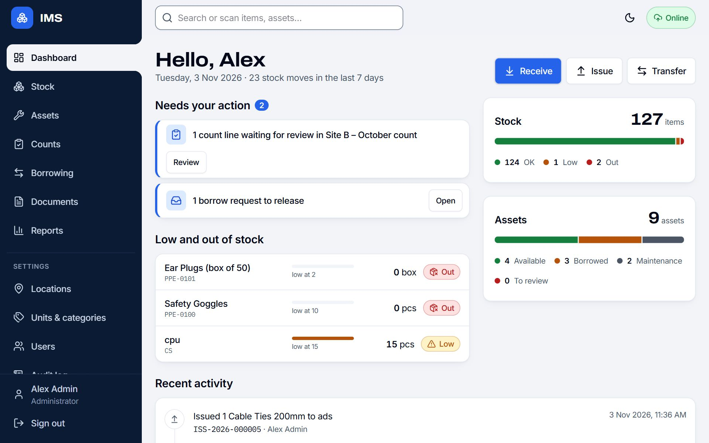

> **Tip:** Receive, Issue, Transfer and Borrow all use the same 4 steps: **Where → What → Who → Review**. The **Next** button names the next step (like **Next: What**). Nothing changes until you press the confirm button on the last step.

### Lists: pages, rows and selecting

Every list (**Stock**, **Counts**, **Borrowing**, **Documents**, **Reports**, **Audit log**) has the same bar at the bottom:

- **Rows per page**: 20, 50, 100 or **All** (Recent activity starts at 10).
- **1–20 of 127**: which rows you're looking at.
- **‹** and **›**: the previous and next page. Your search and filters stay when you change page.

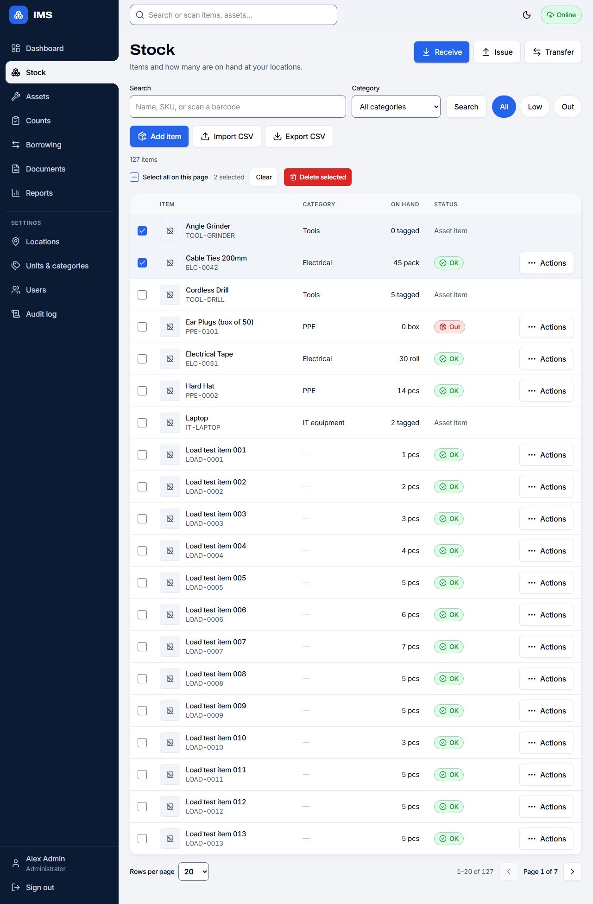

**Remove things added by mistake** (Stock, Counts, Locations, Users; if you're allowed to manage them):

1. Tick the box on each row, or **Select all on this page**.
2. Press **Delete selected**, read the message, then press **Delete**.
3. A message says what was deleted and what was hidden.

> **Tip:** Only records that were never used are deleted. Anything with history (stock moves, loans, counts, forms) is **hidden** instead, so reports and forms stay correct: items and locations become inactive and people can't sign in any more. You can't delete your own account.
>
> **Counts:** a count with nothing counted or decided yet is deleted. An open count that already has counts is **cancelled** (its counts are kept and the location is unfrozen). A closed count is kept for the record.

<!-- part: Office: stock -->

## 4. Add items

### One item

1. Open **Stock** and press **Add item** (below the search box).
2. Fill in **SKU** (a unique code, like `PPE-0001`), **Name** and **Unit**.
3. Optional: **Category**, **Low-stock level**, **Manufacturer barcode**, **Description**. No category yet? Pick **+ New category…** in the list, type the name and press **Add**.
4. Optional: **Photo**. Choose a picture (on a phone you can take one) so everyone knows exactly which item it is.
5. Press **Add item**.

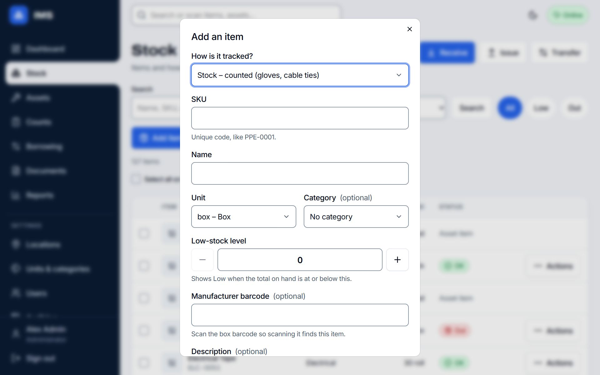

> **Tip:** To add or change a photo later, open the item and press **Add photo** or **Change photo** (or **Remove**). Photos also show as small pictures in the **Stock** list.

**Change an item:** open it and press **Edit** (or **Actions** → **Edit** in the **Stock** list). You can change the name, unit, category, low-stock level and description. The SKU and barcode stay.

### Many items at once (CSV file)

1. Open **Stock** and press **Import CSV**.
2. Press **Download template** and fill it in with Excel (save it as CSV).
3. Press **Choose file** and pick your file.
4. Check the list: rows with a problem are red and say what's wrong. Fix them in the file and choose it again, or import only the good rows.
5. Press **Import … valid rows**.

| Column        | What to put                                 | Required |
| ------------- | ------------------------------------------- | -------- |
| `sku`         | Unique code, like `PPE-0001`                | Yes      |
| `name`        | Item name                                   | Yes      |
| `unit`        | A unit code that already exists, like `pcs` | Yes      |
| `category`    | A category that already exists, like `PPE`  | No       |
| `min_stock`   | Low-stock level                             | No       |
| `description` | Any detail                                  | No       |
| `barcode`     | The manufacturer's barcode number           | No       |

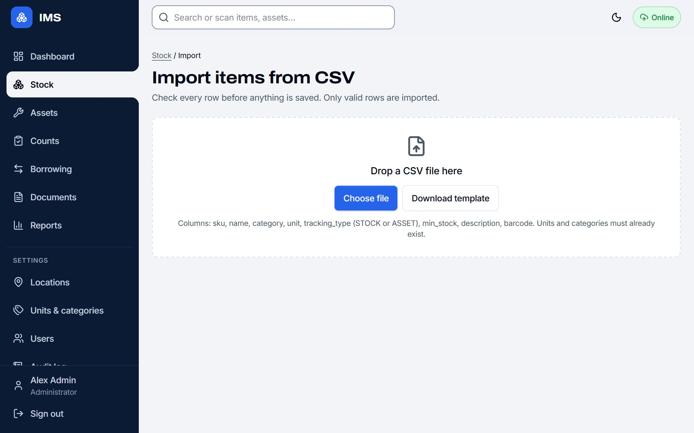

> **Warning:** Units and categories must exist before you import. Add them first in **Units & categories** (section 19).

## 5. Receive stock (a delivery came in)

1. **Dashboard** → **Receive**.
2. **Receive at**: pick the location → **Next**.
3. **Add item**: scan or type the name or SKU, press Enter, then type how many. Repeat for each item → **Next**.
4. Optional: **Received from** (supplier) and **Delivery note / PO number** → **Next**.
5. Check the numbers → **Confirm receipt**.

## 6. Give out stock (Issue)

1. **Dashboard** → **Issue**.
2. **Issue from**: pick the location → **Next**.
3. Add the items and how many → **Next**.

   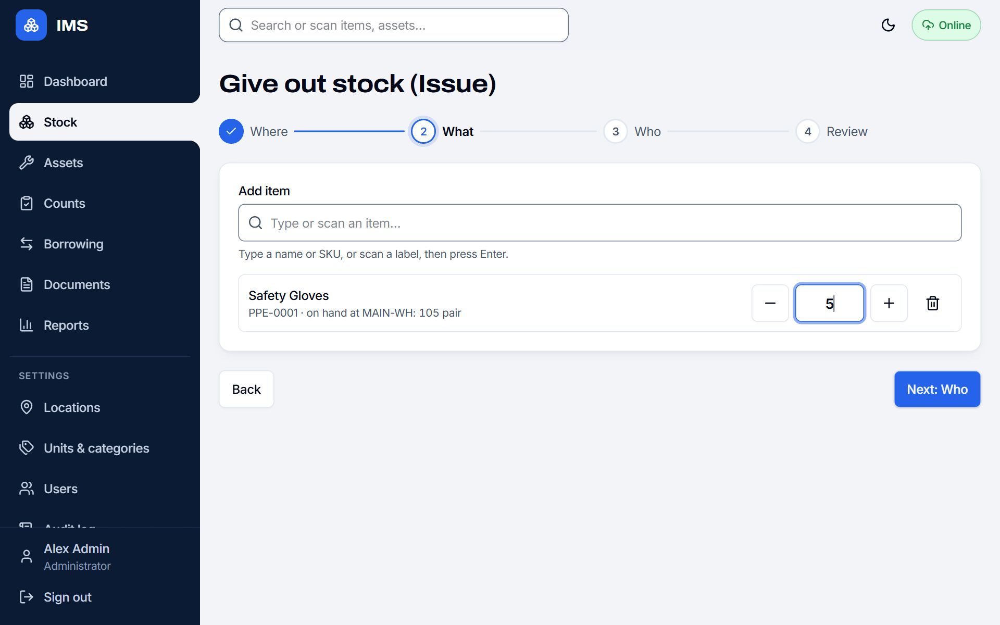

4. **Given to** and **Purpose** (work order or reason) → **Next**.
5. Check the before → after numbers → **Confirm issue**.

   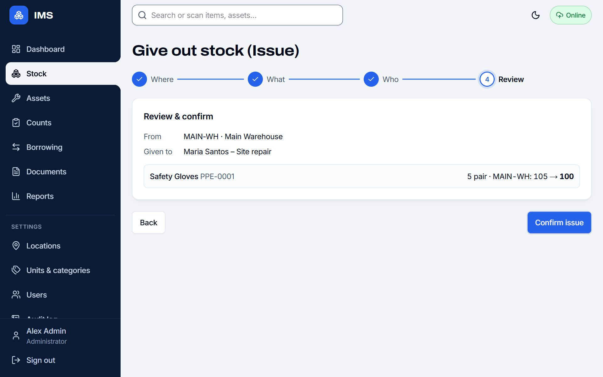

6. Press **Print** or **Download PDF** to get the **Stock Issuance form** for signing.

> **Tip:** If you ask for more than is on hand, IMS says how many are left (like "Only 3 pcs left at MAIN-WH"). Lower the quantity or pick another location.

### Use stock (quick: things used up)

For things used up in the office, like a pack of bond paper:

1. Open the item (or **Actions** → **Use** in the **Stock** list) → **Use**.
2. **Take from**: the stock location it comes out of (only if you have more than one).
3. **How many?** (starts at 1).
4. **Who is using it** (starts with your name; change it, e.g. to Kian) and, optionally, **Where it's used** (e.g. Office) and **What for**.
5. Press **Use …** (like **Use 1 pack**). Stock goes down by that much.

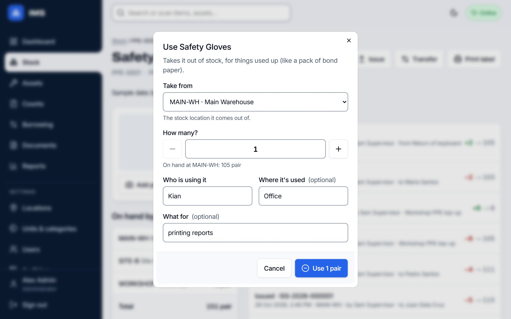

> **Tip:** **Use** is recorded as an issue to the person using it, with the purpose "Used at Office: …", so it shows in the item's movements, Recent activity, reports and counts. To give stock to someone for a job, with a signed form, use **Issue**.

## 7. Move stock to another location (Transfer)

1. **Dashboard** → **Transfer**.
2. **From** and **To** → **Next**.
3. Add the items and how many → **Next**.
4. Optional: **Reason** → **Next**.
5. **Confirm transfer**, then print the **Transmittal form**.

## 8. Find anything

- **Search box** at the top: type or scan a name, SKU or barcode, then press Enter.
- **Scan** → **Type code instead**: start typing, even part of a SKU or name. Matching items and locations appear under the box; tap one to open it.
- **Stock**: tap **Low** or **Out** to see what needs reordering, or pick a category.

  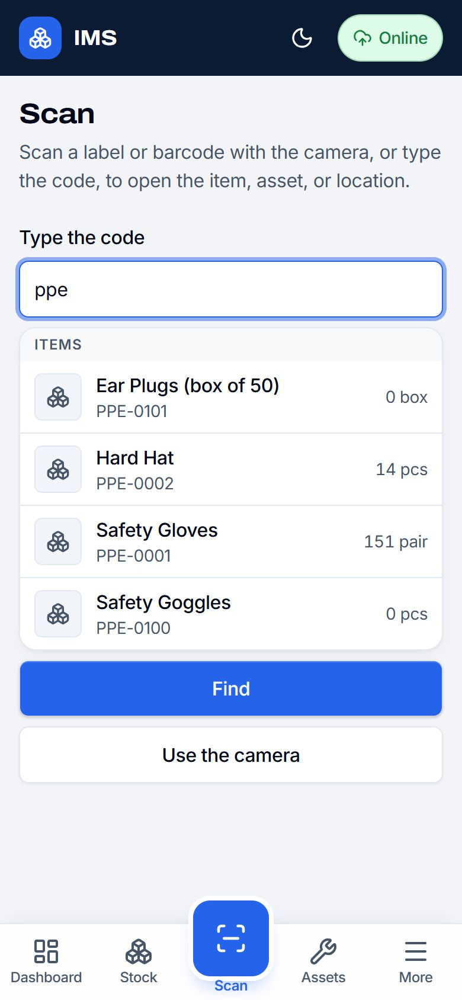

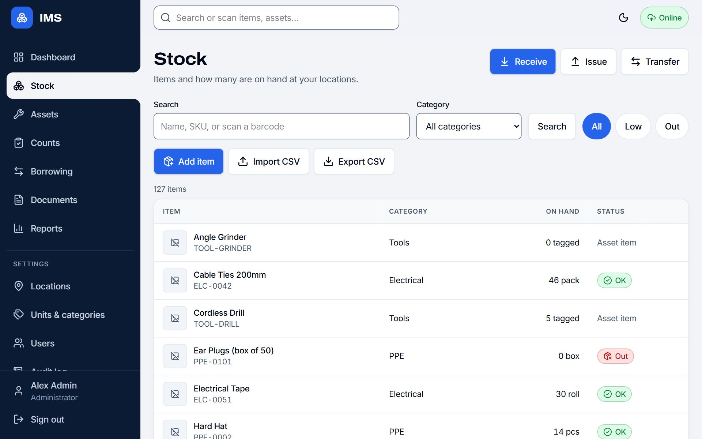

## 9. Print labels

- **One item:** open the item → **Print label**.
- **Locations:** **Locations** → the location's menu → **Print label**.

On the label page, set **Copies each** if you need more than one (press **Update**), then press **Print**.

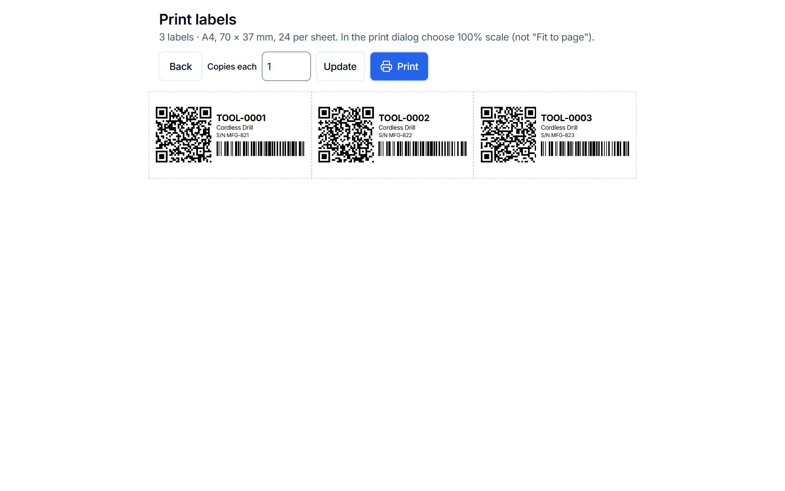

> **Warning:** Use A4 label paper with 3 × 8 labels (70 × 37 mm). In the print window choose **100% scale**, not "Fit to page", or the labels won't line up.

<!-- part: Office: borrowing -->

## 10. Lend items (Borrow)

Lending takes the items out of stock at that location until they come back.

1. **Borrowing** → **Borrow items** (or open an item → **Lend**).
2. **Release from**: the location the items are taken from → **Next**.
3. **Add item**: scan or type the name or SKU and press Enter. Set **How many**, and optionally **Condition** and **Accessories** (like "charger, case"). Each line shows what is on hand there → **Next**.
4. **Borrower** and **Purpose**. Optional: **Department or site**, **Due back**, **Physically received by**, **Notes** → **Next**.
5. Check the before → after numbers. Optional: **Prepared by** (who got the items ready; leave it empty to use your name). **Preview form (DRAFT)** shows the form before anything is saved.
6. **Confirm release**. The quantities leave stock now.
7. Print the **Equipment Borrowing form** and have the borrower sign it.

The **Borrowing** page has tabs: **Requests** (from field staff), **Out now**, **Overdue** (red) and **Closed**. In **Stock**, an item that is out on loan shows **+3 on loan** under its number, and the item page lists who has it.

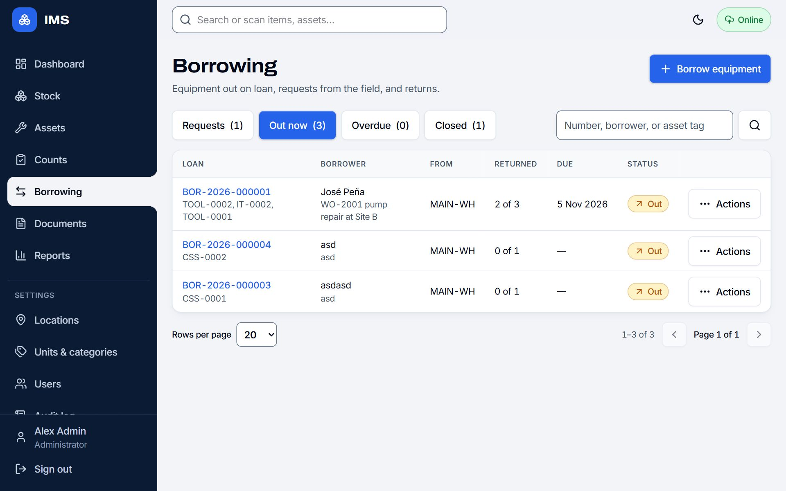

> **Tip:** If you ask for more than is on hand, IMS says how many are left. Lower the quantity or pick another location.

## 11. Take items back (Return)

1. **Borrowing** → open the loan → **Return items**.
2. For each item, type how many came back (or scan them: each scan counts one). **All came back** fills in everything.
3. Optional: **Condition** and **Notes** (like "charger missing"), and photos.
4. **Brought back by** and **Received at**.
5. **Review return** → **Confirm return**, then print the **Return Acknowledgment**.

Everything returned goes back into stock at **Received at**.

> **Tip:** You can return some now and the rest later. The loan stays open until everything is back.

## 12. Close a loan when the rest won't come back

Something was lost, used up or broken beyond use?

1. Return whatever did come back first (section 11).
2. Open the loan → **Close – rest not returned**.
3. Type why → **Close loan** → confirm.

What is still out stays taken out of stock, and the reason is kept in the **Audit log**.

## 13. Release a borrow request from the field

1. **Borrowing** → **Requests** tab.
2. Open the request → **Check and release**.
3. Check the items, quantities and details, then **Confirm release** as in section 10.

<!-- part: Office: stock counts -->

## 14. Start a count

1. **Counts** → **New count**.
2. **Location to count** and a **Name** → **Next**.
3. **Which items**: everything, or only some categories → **Next**.
4. **Who counts**: tick the people → **Next**.
5. Optional: **Finish counting by** and **Instructions for counters** → **Next**.
6. **Create count**.

The counters see it on their phones (section 23).

> **Warning:** While a count is open, stock at that location can't be received, issued or moved, so the numbers stay still. A supervisor can still do it by typing a **Reason for moving stock during the count**; those lines then need a recount.

## 15. Review and close a count

1. **Counts** → open the count. Each line shows what IMS expected and what was counted.
2. For each line:
   - **Approve**: set the stock to the counted number.
   - **Request recount** (in the line's menu): ask for it to be counted again.
   - **Keep expected** (in the line's menu): ignore the counted number.
3. **Approve … with no difference** approves every line that already matches, in one go.
4. When every line is decided → **Close count**. (**Reopen** undoes a close.)
5. Created a count by mistake, or want to stop one? Tick it in **Counts** → **Delete selected**. If nothing was counted yet it is deleted; otherwise it is cancelled.

**Change who counts** (open counts): on the **Counters** card press **Edit**, tick or untick people → **Save counters**. Only people who can count at that location are listed; give someone the location under **Users** first. People taken off can't send more counts; counts they already sent stay.

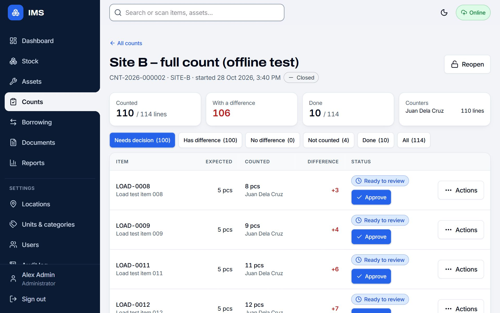

> **Tip:** Counting alone never changes stock. Only **Approve** does, and it records an adjustment (ADJ-…) with your name. If two people counted the same thing differently, IMS asks you which count is right.

<!-- part: Forms, reports and settings -->

## 16. Forms (Documents)

IMS makes 4 forms: **Stock Issuance**, **Transmittal** (transfers), **Equipment Borrowing** (loans) and **Return Acknowledgment**.

1. Open **Documents**.
2. Search by number (like `ISS-2026-000123`) or filter by form.
3. **View**, **Download PDF** or **Print**.

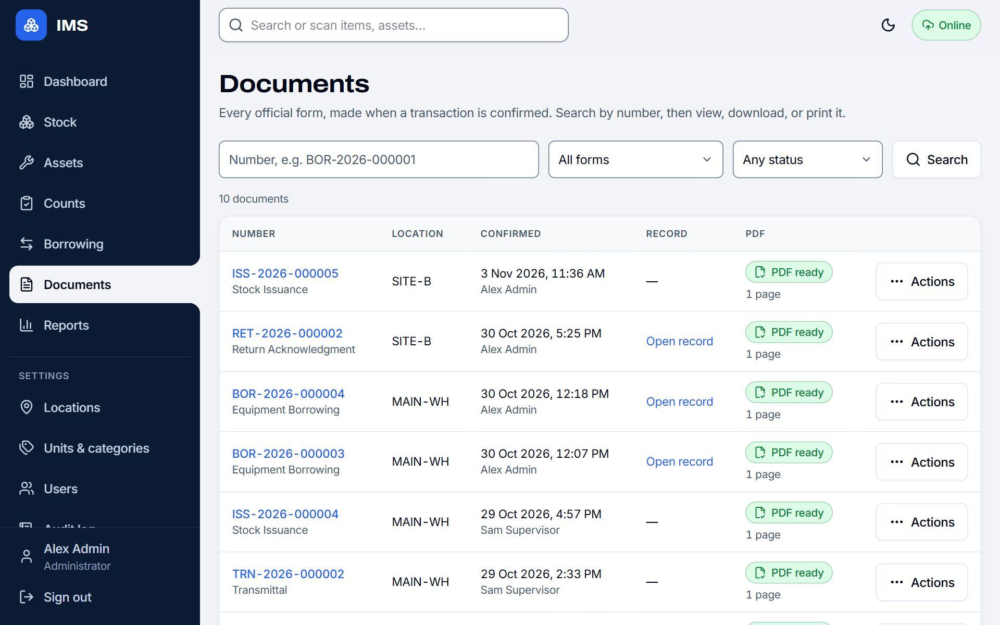

> **Tip:** If a form says "PDF failed", press **Retry PDF**. The stock or loan is already saved; this only remakes the form.

**Company logo on forms (administrators):** **Documents** → **Logo on forms** → **Add logo** → pick a PNG or JPEG. Every new form prints it next to the company name. **Change logo** or **Remove** any time; forms already made keep how they look.

## 17. Reports

1. Open **Reports** and pick one: **Stock balances**, **Movement ledger**, **Items on loan**, **Overdue loans** or **Count discrepancies**.
2. Set the filters (location, dates, item…).
3. Page through the rows on screen, or **Download CSV** to get every row in Excel.

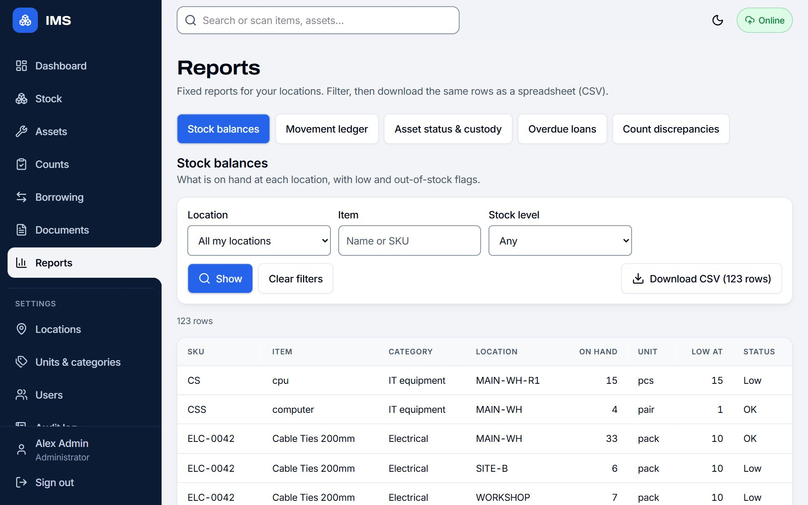

## 18. Locations

1. Open **Locations** → **Add location**.
2. **Code** (short and unique, like `WH-A` or `SITE-B-R1`), **Name**, **Type** (**Warehouse**, **Site** or **Rack / area**) and **Inside** (the location it belongs to, or **Top level (no parent)**).
3. Save.

Each row's menu has **Edit** and **Deactivate**. Codes can't be changed, because labels and forms use them.

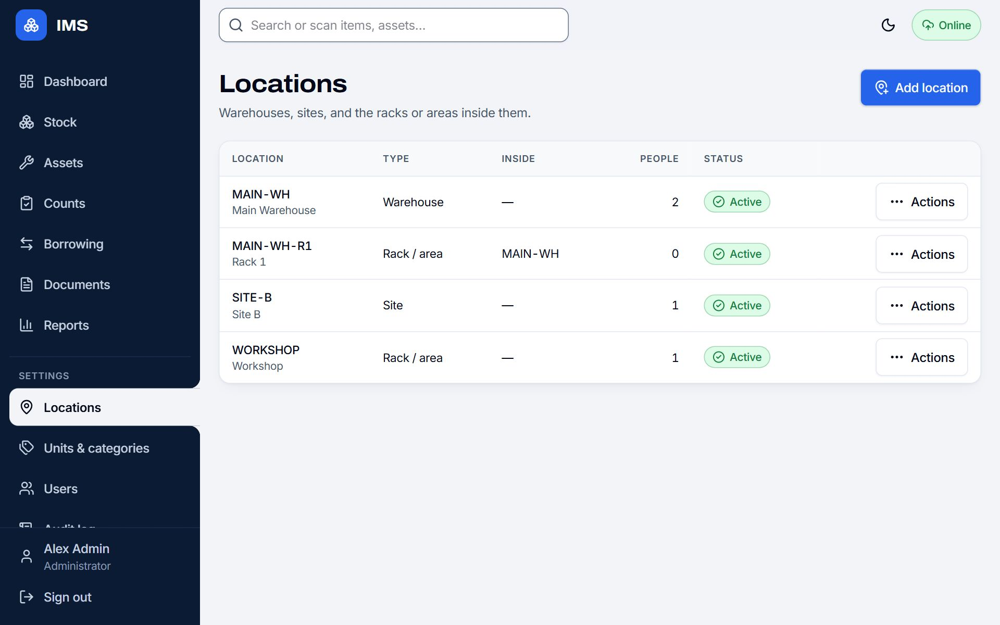

## 19. Units & categories

Open **Units & categories**:

- **Units**: type a **Code** (like `pcs`) and **Name** (like `Piece`) → **Add unit**.
- **Categories**: type a **Name** (like `PPE`) → **Add category**.
- **Change one**: press the pencil next to it, change it → **Save**. Every item using it shows the new name. (Renaming a unit doesn't convert quantities.)

## 20. Users (administrators only)

1. Open **Users** → **Add user**.
2. **Full name**, **Email**, **Temporary password** (give it to the person directly, never by group chat).
3. **Role**: **Field staff**, **Supervisor** or **Administrator**.
4. **Locations**: pick where they work, with **Full** or **View only** access. Access includes everything inside a location.
5. Press **Add user**.

Each user's menu has **Edit**, **Reset link** and **Deactivate**. Deactivating signs the person out everywhere.

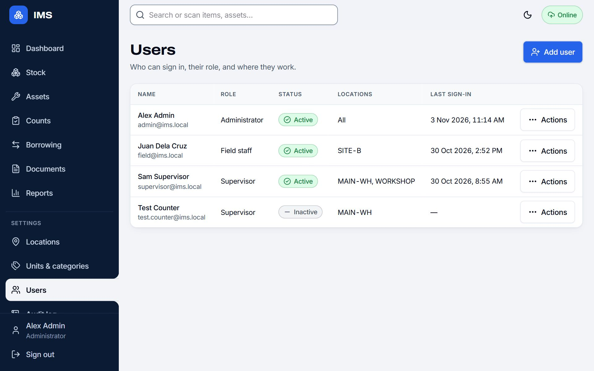

## 21. Audit log (administrators only)

**Audit log** shows who did what and when: sign-ins, stock moves, approvals, changes to items, users and photos. No one can edit or delete entries in IMS.

<!-- part: Phone: field staff -->

## 22. First time (needs internet)

1. Open the IMS link on your phone and sign in.
2. **Me** → **Install IMS on this phone** → follow the steps for Android or iPhone. (On iPhone: Share → **Add to Home Screen**.)
3. From now on, open IMS from the new icon on your home screen.

  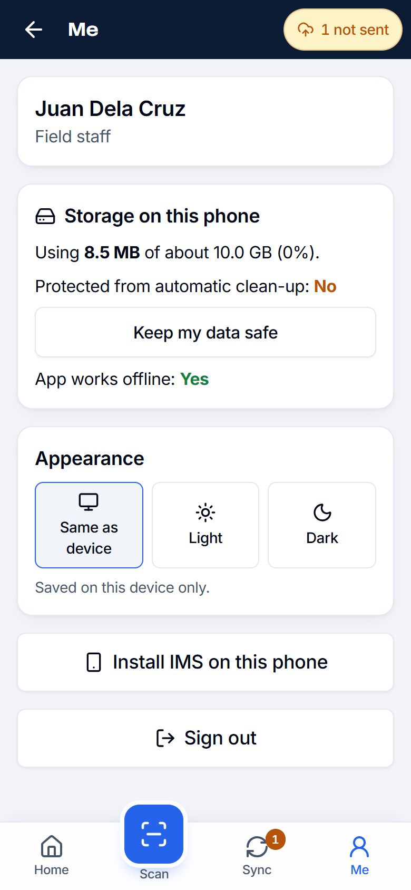

> **Warning:** On iPhone the home-screen app keeps its own storage. Download your assignment again after installing.

## 23. Before you go out (needs internet)

1. **Home** → find your assignment.
2. Press **Download for offline use**.
3. Wait for **Ready for offline use**. Now it works without signal.

  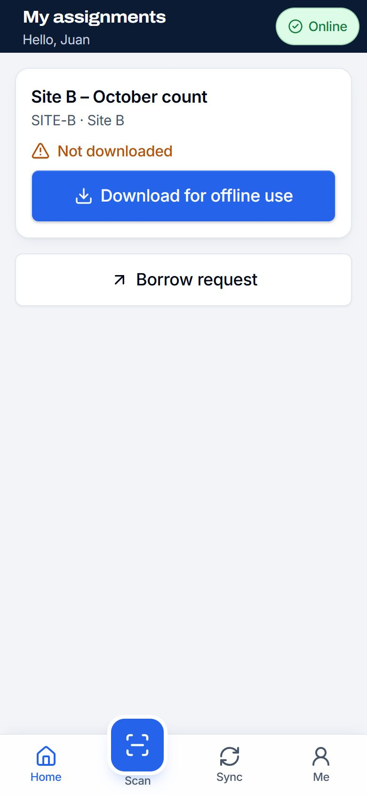
  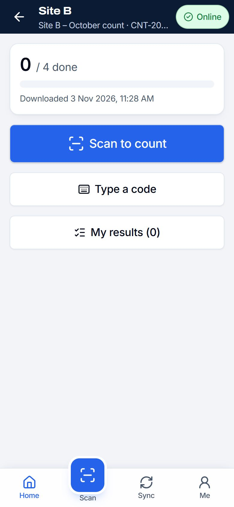

## 24. Count

1. Open the assignment → **Scan to count**.
2. Point the camera at the label. Camera not working? Press **Type a code**.
3. Type how many → **Save count**.
4. Scan the next one.

  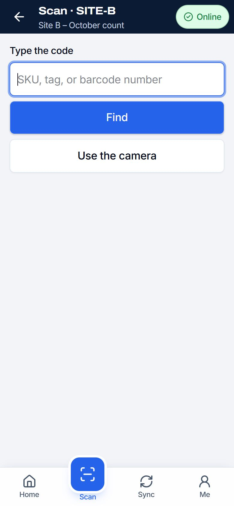
  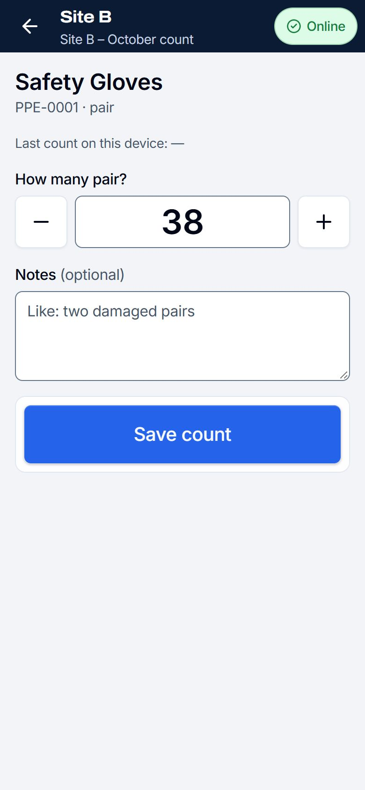

> **Tip:** Scanned the same thing twice? It opens your saved count. It does **not** add it again.

## 25. Check and fix your counts (My results)

1. Open the assignment → **My results**.
2. **Counted** and **Not counted yet** show your progress.
3. Tap any line to change it, then save again.

## 26. Send your counts (needs internet)

1. Open the assignment or **My results**.
2. Press **Send … counts** (like **Send 3 counts**).

The pill at the top shows where your counts are: **3 not sent** means still on your phone; **All sent** means the office has them.

  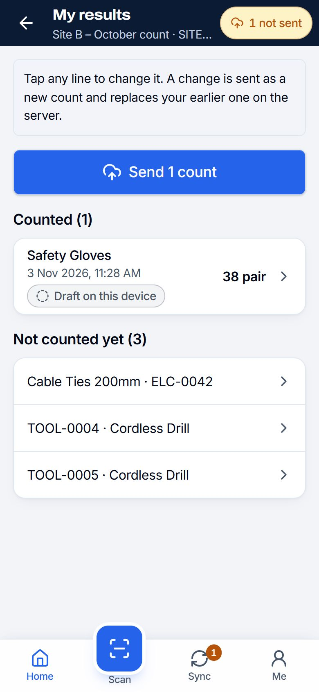
  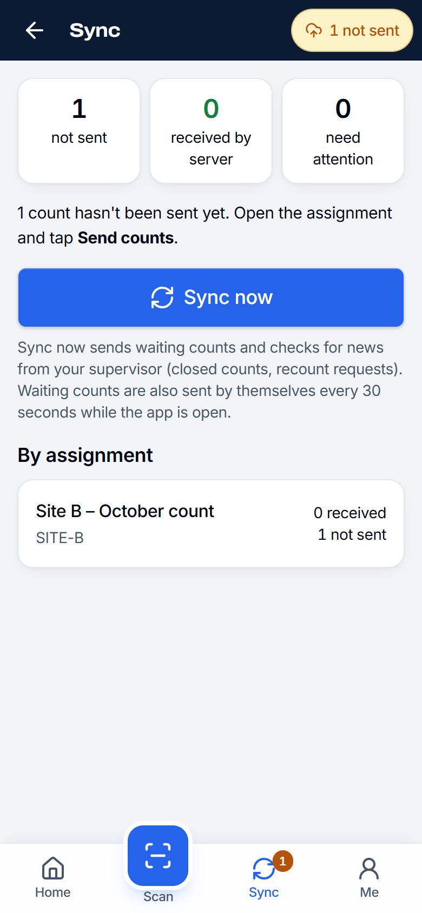

> **Tip:** No signal? Your counts stay safe on the phone. Send them later from **Sync** → **Sync now**.

When the office closes the count, it disappears from your phone by itself once all your counts are sent. If some weren't sent, it stays and shows **Closed**: press **Open Sync** to see them.

## 27. Ask to borrow items

1. **Home** → **Borrow request** → **New borrow request**.
2. **Borrow from**: pick the location.
3. **Items**: type a name or SKU. Matching items appear with how many are on hand; tap **Add**. You can also **Scan a label**. Set **How many** for each.
4. **Borrower** and **Purpose**. Optional: **Department or site**, **Notes**.
5. **Save on this phone**.
6. **Send to supervisor** (needs internet).

  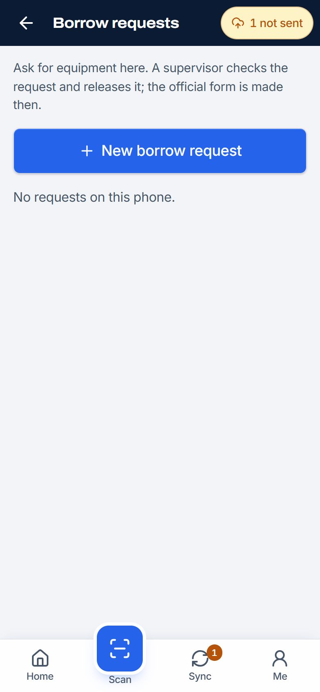

It's only a request. Nothing leaves stock until a supervisor releases it. Offline you can still type or scan a code; the office matches it to the item when you send.

## 28. Me

- **Appearance**: **Same as device**, **Light** or **Dark**.
- **Storage on this phone**: how much space IMS uses.
- **Install IMS on this phone**.
- **Sign out**. If you have counts that aren't sent, IMS warns you first. Signing out needs internet.

<!-- part: Quick reference -->

## 29. I want to…

| I want to…                        | Go to                                                       |
| --------------------------------- | ----------------------------------------------------------- |
| Add stock from a delivery         | **Dashboard** → **Receive**                                 |
| Give stock to someone             | **Dashboard** → **Issue**                                   |
| Use something up (bond paper)     | Open the item → **Use**                                     |
| Move stock between locations      | **Dashboard** → **Transfer**                                |
| Add a new kind of item            | **Stock** → **Add item**                                    |
| Add many items                    | **Stock** → **Import CSV**                                  |
| Change an item                    | Open the item → **Edit**                                    |
| Lend items                        | **Borrowing** → **Borrow items**                            |
| Take items back                   | **Borrowing** → open the loan → **Return items**            |
| Close a loan that won't come back | Open the loan → **Close – rest not returned**               |
| Count a location                  | **Counts** → **New count**                                  |
| Find an item or location          | Search box, or **Scan** → **Type code instead**             |
| Remove something added by mistake | Tick it in the list → **Delete selected**                   |
| Print labels                      | Item → **Print label**                                      |
| Reprint a form                    | **Documents**                                               |
| Get a spreadsheet                 | **Reports** → **Download CSV**                              |
| Get all items in Excel            | **Stock** → **Export CSV**                                  |
| Add a person                      | **Users** → **Add user**                                    |
| Count with my phone               | **Home** → **Download for offline use** → **Scan to count** |

## 30. What the colors mean

| Color     | Means                                          |
| --------- | ---------------------------------------------- |
| 🟢 Green  | OK · Done · All sent                           |
| 🟠 Orange | Low stock · On loan · Not sent yet             |
| 🔴 Red    | Out of stock · Overdue · Problem, needs action |
| ⚪ Grey   | Inactive · Draft                               |

Dark mode: tap the sun / moon button at the top, or **Me** → **Appearance**.

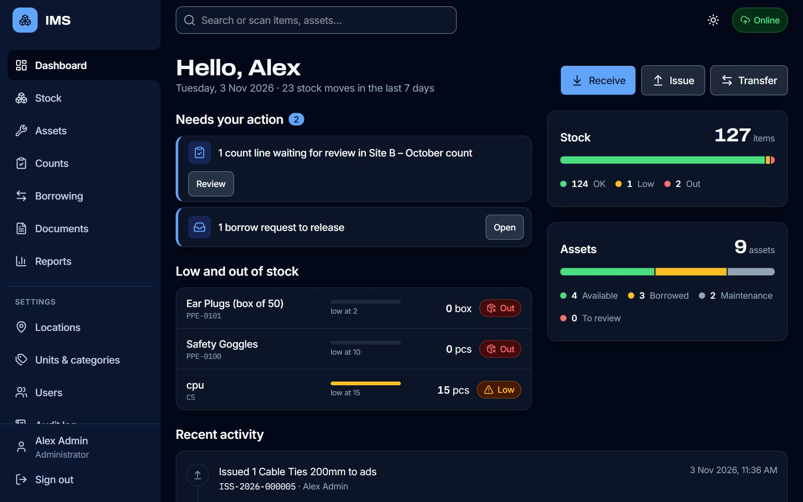

## 31. Problems

| Problem                               | Do this                                                                                                                                                                     |
| ------------------------------------- | --------------------------------------------------------------------------------------------------------------------------------------------------------------------------- |
| Added something by mistake            | Tick it in the list (**Stock**, **Counts**, **Locations** or **Users**) → **Delete selected**. Never-used records are deleted; used ones are hidden so their history stays. |
| "Too many wrong attempts"             | Wait 15 minutes, or ask an administrator for a **Reset link**                                                                                                               |
| "Only 3 left" when issuing or lending | Lower the quantity or pick another location                                                                                                                                 |
| Stock moves are blocked at a location | A count is open there. Finish it, or give a reason to move stock during the count                                                                                           |
| "PDF failed"                          | **Documents** → **Retry PDF**                                                                                                                                               |
| CSV rows are red                      | Read the reason on each row; often the unit or category doesn't exist yet                                                                                                   |
| Labels don't line up                  | Print at **100% scale** on 3 × 8 (70 × 37 mm) A4 label paper                                                                                                                |
| Camera won't open                     | Allow the camera for IMS in the phone settings, or use **Type a code**                                                                                                      |
| "Not downloaded"                      | Get internet, then **Download for offline use**                                                                                                                             |
| Counts stuck on "not sent"            | Get internet → **Sync** → **Sync now**                                                                                                                                      |

## 32. Don't

- **Don't clear browser data or uninstall IMS** while counts are not sent. Unsent counts would be lost.
- **Don't share your account.** Everything you do is recorded under your name.
- **Don't go out of signal without downloading** your assignment first.

## 33. Words used in IMS

| Word                | Means                                                           |
| ------------------- | --------------------------------------------------------------- |
| **SKU**             | The item's unique code, like `PPE-0001`                         |
| **Location**        | A warehouse, site, or rack / area inside one                    |
| **Receive**         | Stock coming in                                                 |
| **Issue**           | Stock going out, not coming back                                |
| **Transfer**        | Stock moving between two locations                              |
| **Borrow / Return** | Items lent out of stock and brought back into it                |
| **On loan**         | Lent and not back yet; already taken out of the on-hand number  |
| **Count**           | Checking what is really on the shelf against what IMS says      |
| **Adjustment**      | The change to stock when a count difference is approved (ADJ-…) |
| **Low-stock level** | When on-hand stock falls to this number, IMS shows it as Low    |
