# How to use IMS

IMS (Inventory Management System) tracks two kinds of things:

- **Stock**: things you count and give out, like gloves, pants or cable ties. IMS keeps the number on hand at each location.
- **Assets**: equipment you lend out and get back, like drills or laptops. Each one has its own tag (like TOOL-0001) and its own history.

It works on a phone, tablet or computer. Words in **bold** are exactly what you see on screen. Pictures use sample data.

<!-- part: Getting started -->

## 1. Sign in

1. Open the IMS link your company gave you.
2. Type your **Email** and **Password**.
3. Press **Sign in**.

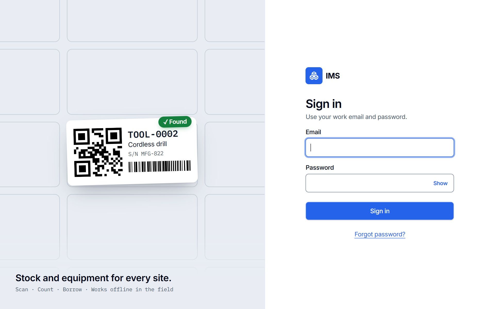

> **Forgot your password?** Ask an administrator. They open **Users**, choose **Reset link** on your name, and send you the link. Open it, type a new password twice (at least 10 characters), then press **Save new password**.

> **Warning:** 5 wrong passwords in 15 minutes lock your email for 15 minutes. An administrator's **Reset link** unlocks it straight away.

## 2. Who can do what

| You are           | You can                                                                                                                          |
| ----------------- | -------------------------------------------------------------------------------------------------------------------------------- |
| **Administrator** | Everything, at every location, plus **Users** and the **Audit log**                                                              |
| **Supervisor**    | At your locations: add items and assets, receive, issue and transfer stock, lend and take back equipment, run and approve counts |
| **Field staff**   | Count with your phone (works without internet) and send borrow requests                                                          |

## 3. Stock or asset? Decide before you add an item

Ask: **"Do I need to know _which one_?"**

| Stock                                          | Asset                                                   |
| ---------------------------------------------- | ------------------------------------------------------- |
| No. Any pair of pants is the same              | Yes. _This_ laptop went to Juan and is due back Friday  |
| Kept as a number: "3 pair at MAIN-WH"          | Each unit has its own tag: LAP-0001, LAP-0002…          |
| Comes in with **Receive**                      | Comes in with **Add assets**                            |
| Goes out with **Issue** (it doesn't come back) | Goes out with **Borrow** and comes back with **Return** |

> **Warning:** You can't change this later. If you pick the wrong one, make a new item with a new SKU.

## 4. Finding your way

**On a computer**, the menu is on the left:

- **Dashboard**, **Stock**, **Assets**, **Counts**, **Borrowing**, **Documents**, **Reports**
- Under **Settings**: **Locations**, **Units & categories**, **Users**, **Audit log** (you only see what your role allows)
- At the bottom: your name (your **Me** page) and **Sign out**

**On a phone**, the bar at the bottom has **Dashboard**, **Stock**, **Scan**, **Assets** and **More** (everything else).

At the top of every page:

- **Search box**: type or scan a name, SKU, asset tag, serial or barcode.
- **Sun / moon button**: switches between light and dark.
- **Online** pill: green when IMS can reach the server.

### The dashboard

The **Dashboard** opens when you sign in.

- **Needs your action** is your to-do list: counts to review, borrow requests, overdue loans and failed forms. Clear it and your day is done.
- **Low and out of stock** shows what needs reordering.
- **Receive**, **Issue** and **Transfer** buttons are at the top right.

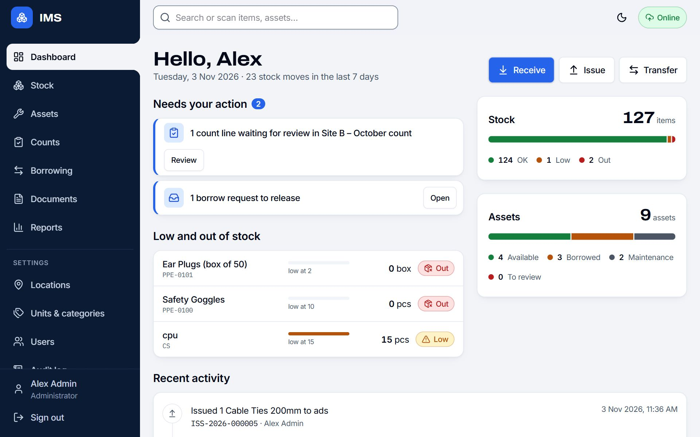

> **Tip:** Receive, Issue, Transfer and Borrow all use the same 4 steps: **Where → What → Who → Review**. The **Next** button names the next step (like **Next: What**). Nothing changes until you press the confirm button on the last step.

<!-- part: Office: stock -->

## 5. Add items

### One item

1. Open **Stock** and press **Add item** (below the search box).
2. **How is it tracked?**: choose **Stock** or **Asset** (see section 3).
3. Fill in **SKU** (a unique code, like `PPE-0001`), **Name** and **Unit**.
4. Optional: **Category**, **Low-stock level** (stock only), **Manufacturer barcode**, **Description**.
5. Optional: **Photo**. Choose a picture (on a phone you can take one) so everyone knows exactly which item it is.
6. Press **Add item**.

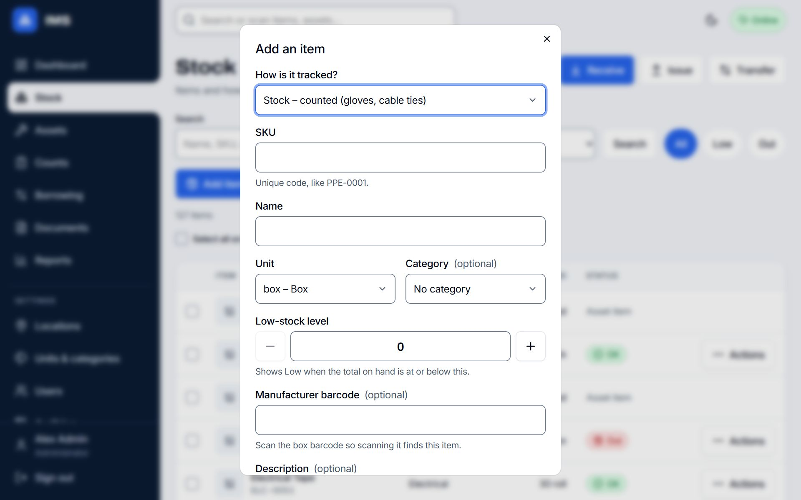

> **Tip:** To add or change a photo later, open the item and press **Add photo** or **Change photo** (or **Remove**). Photos also show as small pictures in the **Stock** list.

### Many items at once (CSV file)

1. Open **Stock** and press **Import CSV**.
2. Press **Download template** and fill it in with Excel (save it as CSV).
3. Press **Choose file** and pick your file.
4. Check the list: rows with a problem are red and say what's wrong. Fix them in the file and choose it again, or import only the good rows.
5. Press **Import … valid rows**.

| Column          | What to put                                 | Required |
| --------------- | ------------------------------------------- | -------- |
| `sku`           | Unique code, like `PPE-0001`                | Yes      |
| `name`          | Item name                                   | Yes      |
| `unit`          | A unit code that already exists, like `pcs` | Yes      |
| `tracking_type` | `STOCK` or `ASSET`                          | Yes      |
| `category`      | A category that already exists, like `PPE`  | No       |
| `min_stock`     | Low-stock level (stock only)                | No       |
| `description`   | Any detail                                  | No       |
| `barcode`       | The manufacturer's barcode number           | No       |

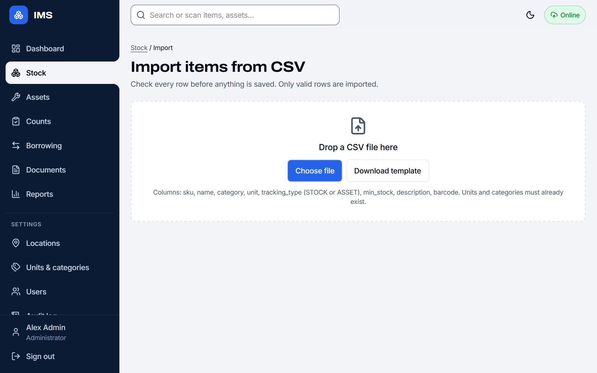

> **Warning:** Units and categories must exist before you import. Add them first in **Units & categories** (section 21).

## 6. Receive stock (a delivery came in)

1. **Dashboard** → **Receive**.
2. **Receive at**: pick the location → **Next**.
3. **Add item**: scan or type the name or SKU, press Enter, then type how many. Repeat for each item → **Next**.
4. Optional: **Received from** (supplier) and **Delivery note / PO number** → **Next**.
5. Check the numbers → **Confirm receipt**.

## 7. Give out stock (Issue)

1. **Dashboard** → **Issue**.
2. **Issue from**: pick the location → **Next**.
3. Add the items and how many → **Next**.

   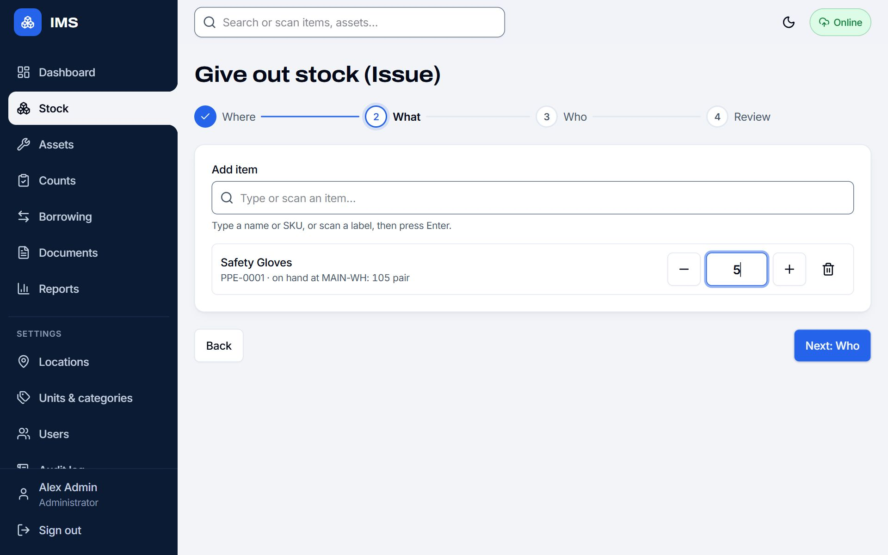

4. **Given to** and **Purpose** (work order or reason) → **Next**.
5. Check the before → after numbers → **Confirm issue**.

   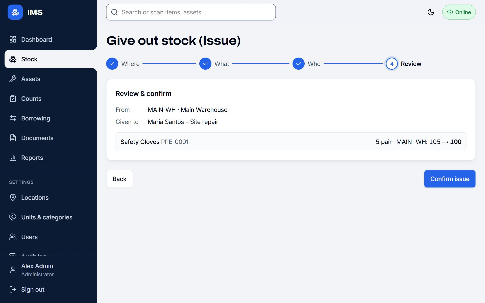

6. Press **Print** or **Download PDF** to get the **Stock Issuance form** for signing.

> **Tip:** If you ask for more than is on hand, IMS says how many are left (like "Only 3 pcs left at MAIN-WH"). Lower the quantity or pick another location.

### Use stock (quick: things used up)

For things used up in the office, like a pack of bond paper:

1. Open the item (or **Actions** → **Use** in the **Stock** list) → **Use**.
2. **Take from**: the stock location it comes out of (only if you have more than one).
3. **How many?** (starts at 1).
4. **Who is using it** (starts with your name; change it, e.g. to Kian) and, optionally, **Where it's used** (e.g. Office) and **What for**.
5. Press **Use …** (like **Use 1 pack**). Stock goes down by that much.

> **Tip:** **Use** is recorded as an issue to the person using it, with the purpose "Used at Office: …", so it shows in the item's movements, Recent activity, reports and counts. To give stock to someone for a job, with a signed form, use **Issue**.

## 8. Move stock to another location (Transfer)

1. **Dashboard** → **Transfer**.
2. **From** and **To** → **Next**.
3. Add the items and how many → **Next**.
4. Optional: **Reason** → **Next**.
5. **Confirm transfer**, then print the **Transmittal form**.

## 9. Find anything

- **Search box** at the top: type or scan a name, SKU, asset tag, serial or barcode, then press Enter.
- **Scan** → **Type code instead**: start typing, even part of a SKU or name. Matching items, assets and locations appear under the box; tap one to open it.
- **Stock**: tap **Low** or **Out** to see what needs reordering, or pick a category.

  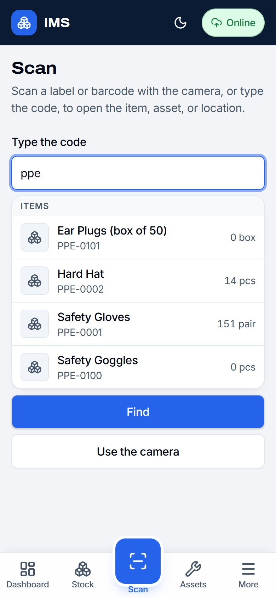

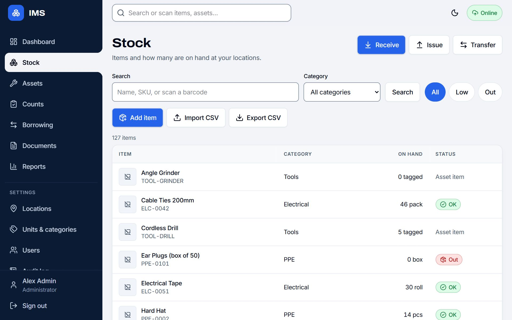

## 10. Print labels

- **One item:** open the item → **Print label**.
- **One asset:** open the asset → **Print label**.
- **Many assets:** **Assets** → search or filter → **Print labels for this page**.

On the label page, set **Copies each** if you need more than one (press **Update**), then press **Print**.

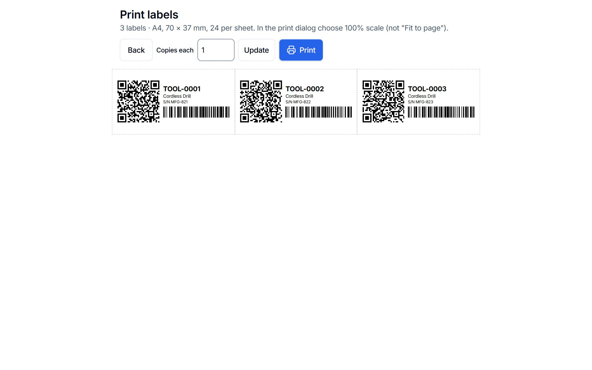

> **Warning:** Use A4 label paper with 3 × 8 labels (70 × 37 mm). In the print window choose **100% scale**, not "Fit to page", or the labels won't line up.

<!-- part: Office: equipment -->

## 11. Add equipment (assets)

1. First make the item with **How is it tracked?** = **Asset** (section 5).
2. Open **Assets** → **Add assets** (or open the item → **Add assets**).
3. **Asset item**: type the item's SKU and pick it.
4. **Location**: where it's kept.
5. **How many?**: one tag is made for each.
6. **Tag prefix**: a short code like `LAP`. Tags become LAP-0001, LAP-0002…
7. **Condition**: Good, Fair or Damaged.
8. Optional: **Serial numbers** (one per line, same order as the tags), **Custodian**, **Notes**.
9. Press **Add … assets**.
10. Press **Print … labels** and stick one label on each unit.

## 12. See or change one asset

Open **Assets** → tap the asset. You see its details and its full history.

- **Borrow**: lend it (only when it's **Available**).
- **Return**: take it back (only when it's **Borrowed**).
- **Change status**: for example **Under maintenance**, **Needs review**, **Lost** or **Retired**. You must give a reason.
- **Print label**: reprint a lost or damaged label.

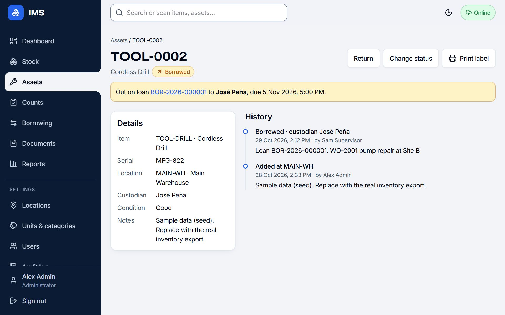

| Status                | Means                                  | What can happen next                          |
| --------------------- | -------------------------------------- | --------------------------------------------- |
| **Available**         | Ready to lend                          | Borrow, or change status                      |
| **Borrowed**          | Out on a loan                          | Return (or mark Lost)                         |
| **Under maintenance** | Being repaired                         | Back to Available when fixed                  |
| **Needs review**      | Came back damaged, or a count found it | Check it, then Available or Under maintenance |
| **Lost**              | Can't be found                         | If found: Needs review first                  |
| **Retired**           | No longer used                         | Nothing (permanent)                           |

## 13. Lend equipment (Borrow)

1. **Borrowing** → **Borrow equipment**.
2. **Release from**: where the equipment is now → **Next**.
3. **Add asset**: scan or type each tag and press Enter. Set **Condition** and **Accessories** (like "charger, case") → **Next**.
4. **Borrower** and **Purpose**. Optional: **Department or site**, **Due back**, **Physically received by**, **Notes** → **Next**.
5. Check everything. Optional: **Prepared by** (who got the equipment ready; leave it empty to use your name). **Preview form (DRAFT)** shows the form before anything is saved.
6. **Confirm release**.
7. Print the **Equipment Borrowing form** and have the borrower sign it.

The **Borrowing** page has tabs: **Requests** (from field staff), **Out now**, **Overdue** (red) and **Closed**.

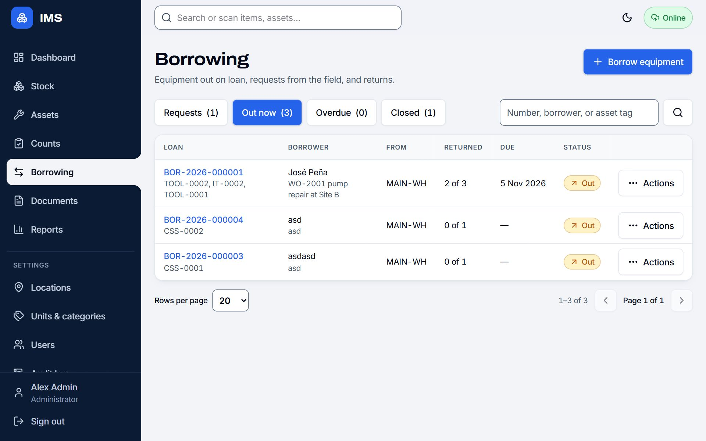

## 14. Take equipment back (Return)

1. **Borrowing** → open the loan → **Return equipment**.
2. Tick each asset that came back.
3. **Condition now** for each. If it's **Damaged**, pick **Send to**: **Needs review** or **Under maintenance**.
4. Optional: **Missing accessories**, **Notes**.
5. **Brought back by** and **Received at**.
6. **Confirm return**, then print the **Return Acknowledgment**.

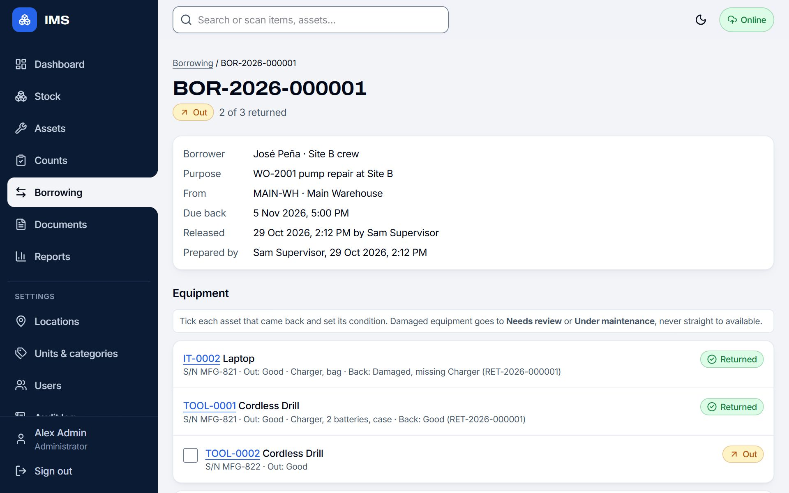

> **Tip:** You can return some items now and the rest later. The loan stays open until everything is back.

## 15. Release a borrow request from the field

1. **Borrowing** → **Requests** tab.
2. Open the request → **Check and release**.
3. Check the assets and details, then **Confirm release** as in section 13.

<!-- part: Office: stock counts -->

## 16. Start a count

1. **Counts** → **New count**.
2. **Location to count** and a **Name** → **Next**.
3. **Count**: **Stock quantities** and/or **Tagged assets**. **Which items**: everything, or only some categories → **Next**.
4. **Who counts**: tick the people → **Next**.
5. Optional: **Finish counting by** and **Instructions for counters** → **Next**.
6. **Create count**.

The counters see it on their phones (section 25).

> **Warning:** While a count is open, stock at that location can't be received, issued or moved, so the numbers stay still. A supervisor can still do it by typing a **Reason for moving stock during the count**; those lines then need a recount.

## 17. Review and close a count

1. **Counts** → open the count. Each line shows what IMS expected and what was counted.
2. For each line:
   - **Approve**: set the stock to the counted number.
   - **Request recount** (in the line's menu): ask for it to be counted again.
   - **Keep expected** (in the line's menu): ignore the counted number.
3. **Approve … with no difference** approves every line that already matches, in one go.
4. When every line is decided → **Close count**. (**Reopen** undoes a close.)

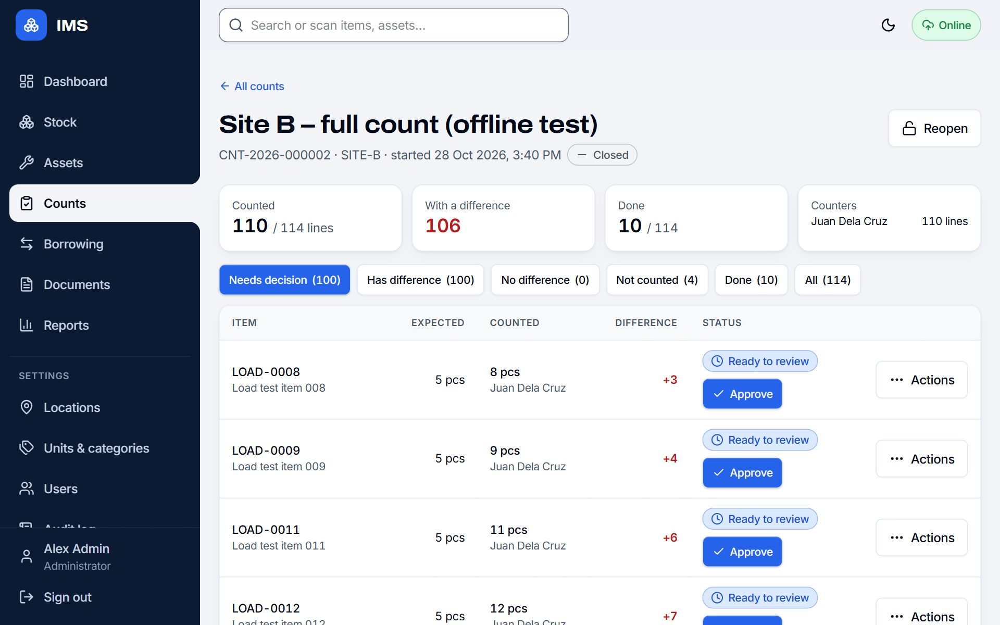

> **Tip:** Counting alone never changes stock. Only **Approve** does, and it records an adjustment (ADJ-…) with your name. If two people counted the same thing differently, IMS asks you which count is right.

<!-- part: Forms, reports and settings -->

## 18. Forms (Documents)

IMS makes 4 forms: **Stock Issuance**, **Transmittal** (transfers), **Equipment Borrowing** and **Return Acknowledgment**.

1. Open **Documents**.
2. Search by number (like `ISS-2026-000123`) or filter by form.
3. **View**, **Download PDF** or **Print**.

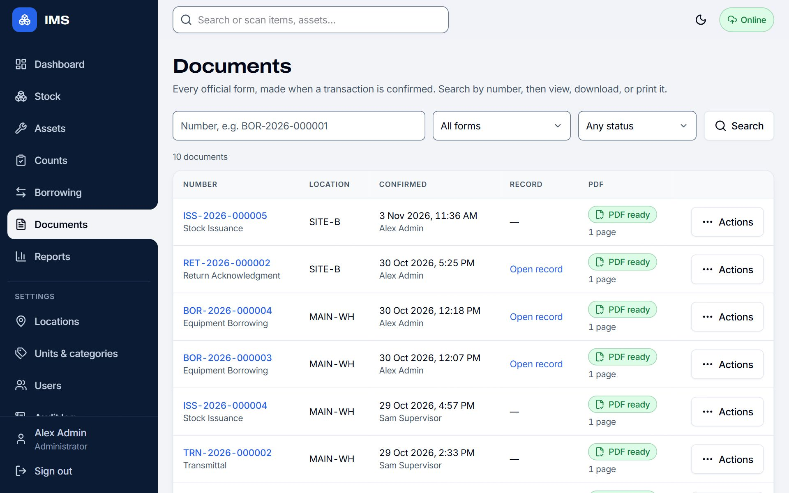

> **Tip:** If a form says "PDF failed", press **Retry PDF**. The stock or loan is already saved; this only remakes the form.

## 19. Reports

1. Open **Reports** and pick one: **Stock balances**, **Movement ledger**, **Asset status & custody**, **Overdue loans** or **Count discrepancies**.
2. Set the filters (location, dates, item…).
3. **Download CSV** to open it in Excel.

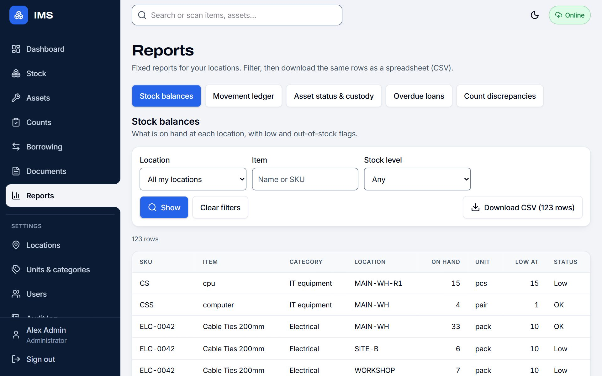

## 20. Locations

1. Open **Locations** → **Add location**.
2. **Code** (short and unique, like `WH-A` or `SITE-B-R1`), **Name**, **Type** (**Warehouse**, **Site** or **Rack / area**) and **Inside** (the location it belongs to, or **Top level (no parent)**).
3. Save.

Each row's menu has **Edit** and **Deactivate**. Codes can't be changed, because labels and forms use them.

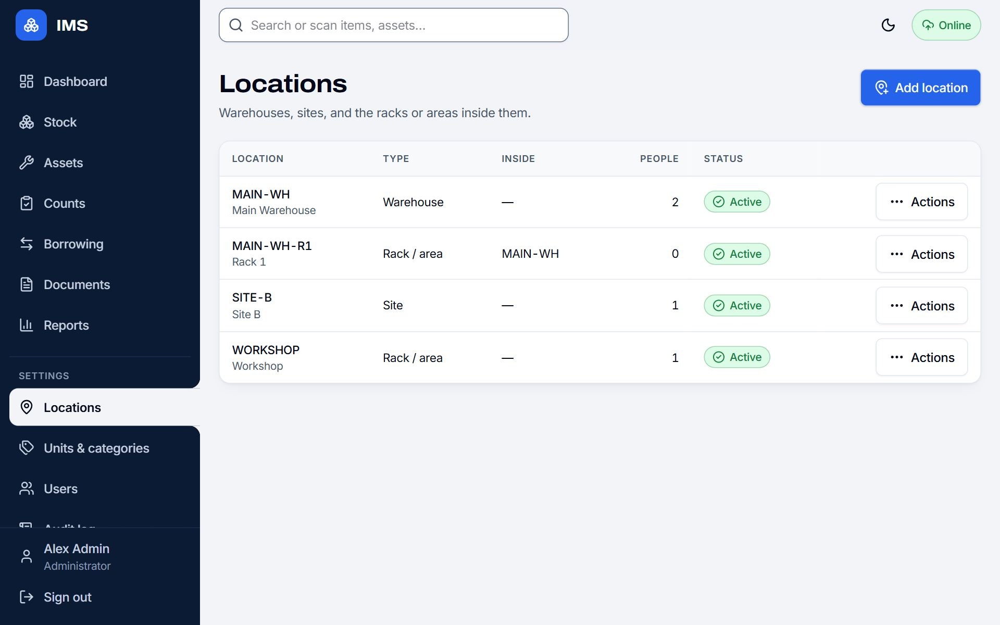

## 21. Units & categories

Open **Units & categories**:

- **Units**: type a **Code** (like `pcs`) and **Name** (like `Piece`) → **Add unit**.
- **Categories**: type a **Name** (like `PPE`) → **Add category**.

## 22. Users (administrators only)

1. Open **Users** → **Add user**.
2. **Full name**, **Email**, **Temporary password** (give it to the person directly, never by group chat).
3. **Role**: **Field staff**, **Supervisor** or **Administrator**.
4. **Locations**: pick where they work, with **Full** or **View only** access. Access includes everything inside a location.
5. Press **Add user**.

Each user's menu has **Edit**, **Reset link** and **Deactivate**. Deactivating signs the person out everywhere.

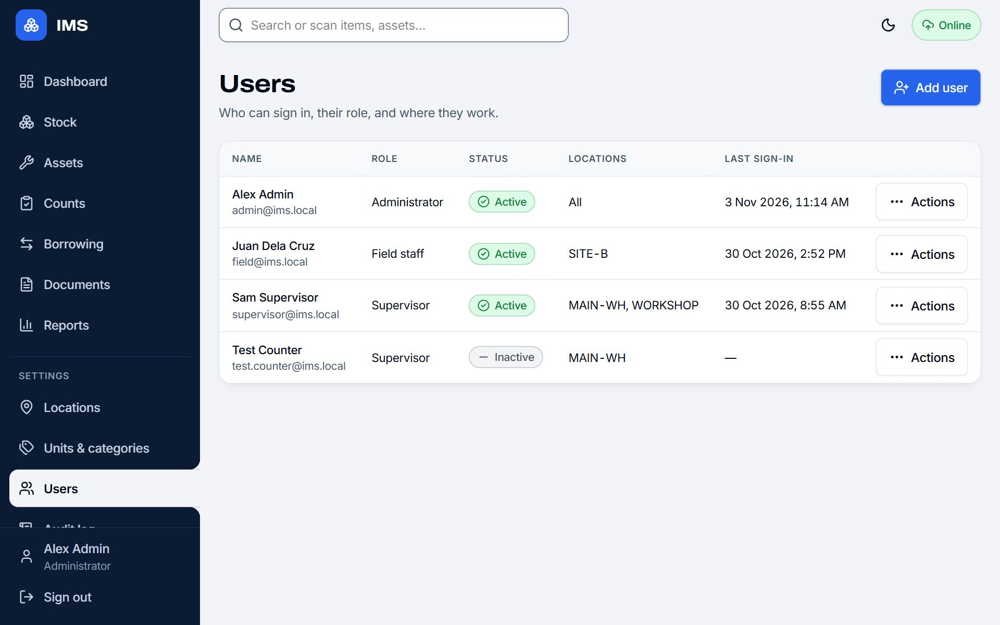

## 23. Audit log (administrators only)

**Audit log** shows who did what and when: sign-ins, stock moves, approvals, changes to items, users and photos. No one can edit or delete entries in IMS.

<!-- part: Phone: field staff -->

## 24. First time (needs internet)

1. Open the IMS link on your phone and sign in.
2. **Me** → **Install IMS on this phone** → follow the steps for Android or iPhone. (On iPhone: Share → **Add to Home Screen**.)
3. From now on, open IMS from the new icon on your home screen.

  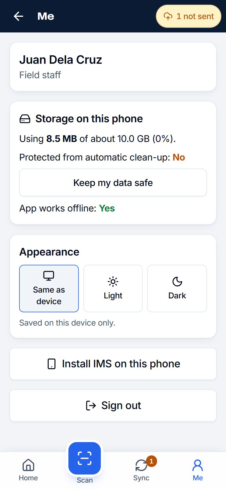

> **Warning:** On iPhone the home-screen app keeps its own storage. Download your assignment again after installing.

## 25. Before you go out (needs internet)

1. **Home** → find your assignment.
2. Press **Download for offline use**.
3. Wait for **Ready for offline use**. Now it works without signal.

  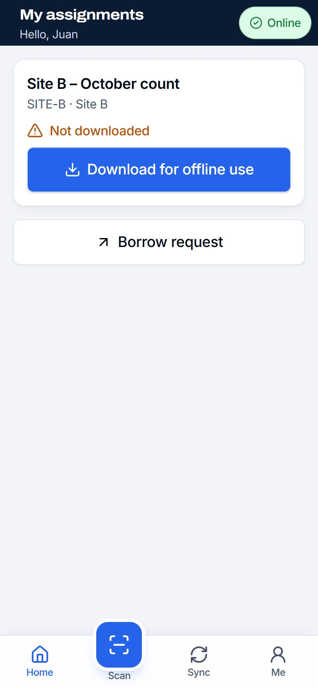
  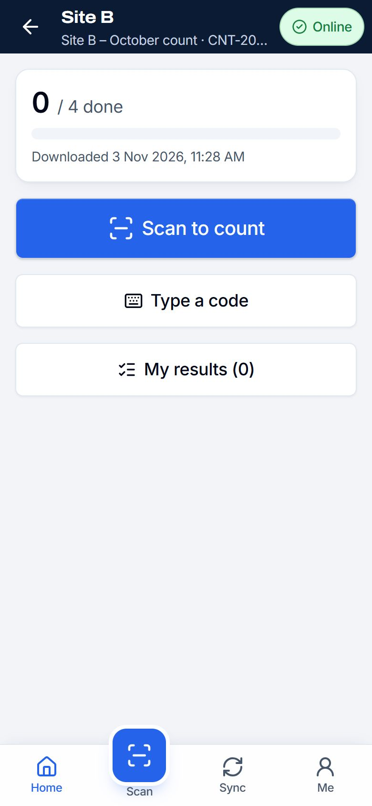

## 26. Count

1. Open the assignment → **Scan to count**.
2. Point the camera at the label. Camera not working? Press **Type a code**.
3. **Stock item:** type how many → **Save count**.
4. **Equipment:** tap **Found** or **Not found**. If found, pick the condition → **Save check**.
5. Scan the next one.

  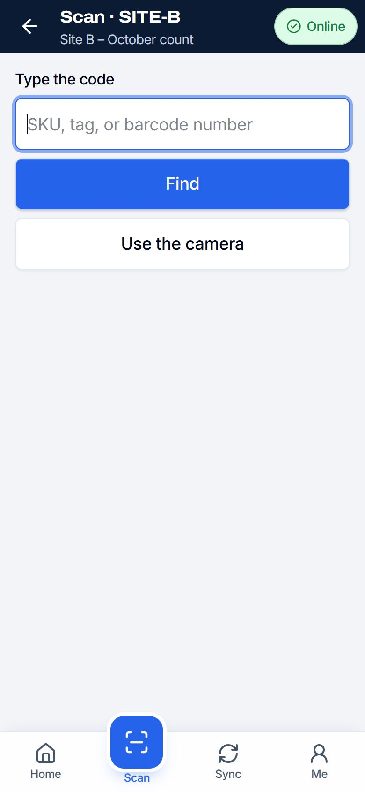
  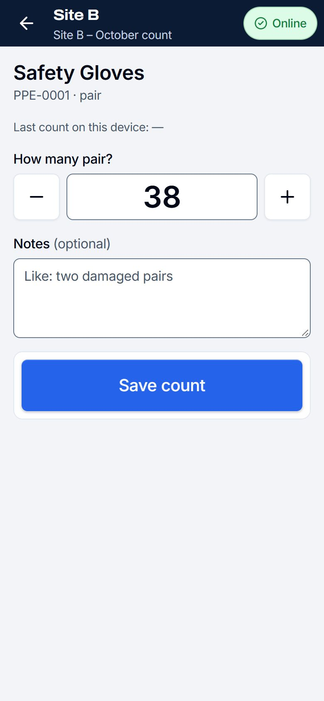

> **Tip:** Scanned the same thing twice? It opens your saved count. It does **not** add it again.

## 27. Check and fix your counts (My results)

1. Open the assignment → **My results**.
2. **Counted** and **Not counted yet** show your progress.
3. Tap any line to change it, then save again.

## 28. Send your counts (needs internet)

1. Open the assignment or **My results**.
2. Press **Send … counts** (like **Send 3 counts**).

The pill at the top shows where your counts are: **3 not sent** means still on your phone; **All sent** means the office has them.

  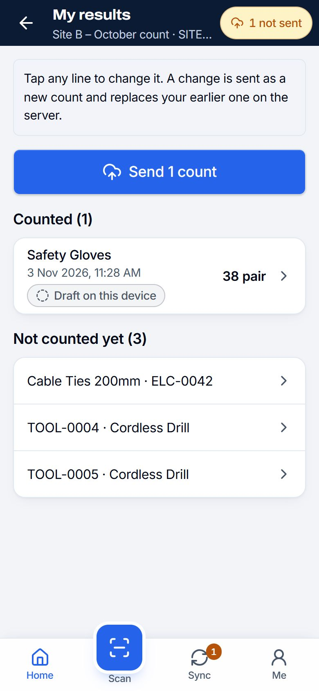
  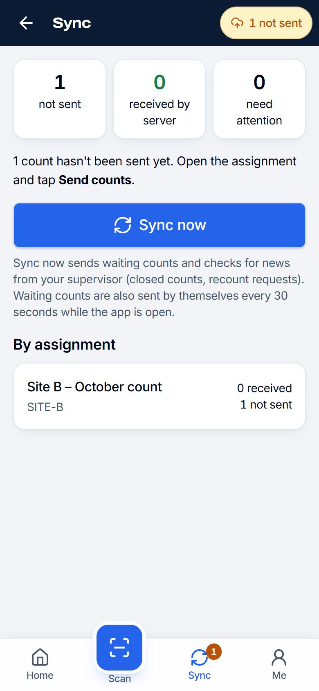

> **Tip:** No signal? Your counts stay safe on the phone. Send them later from **Sync** → **Sync now**.

## 29. Ask to borrow equipment

1. **Home** → **Borrow request** → **New borrow request**.
2. **Equipment is at**: pick the location.
3. **Assets**: type a tag or name. Matching equipment appears; tap **Add** on one marked **Available**. Red text means it can't be borrowed (already out, under maintenance…) or isn't at that location. You can also **Scan a label**.
4. **Borrower** and **Purpose**. Optional: **Department or site**, **Notes**.
5. **Save on this phone**.
6. **Send to supervisor** (needs internet).

  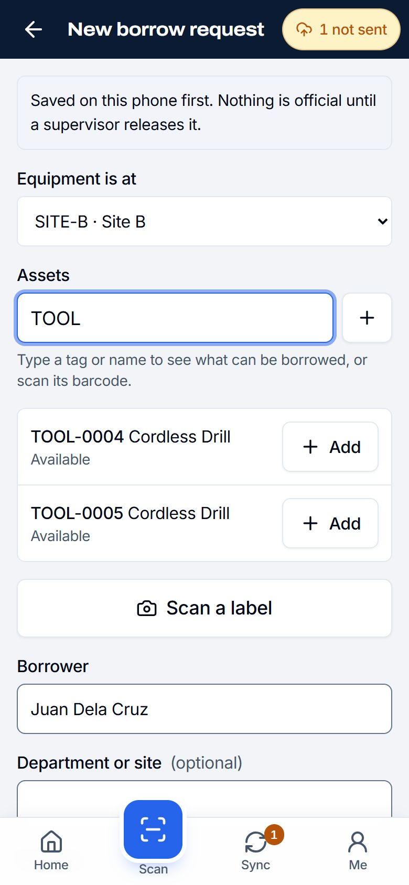
  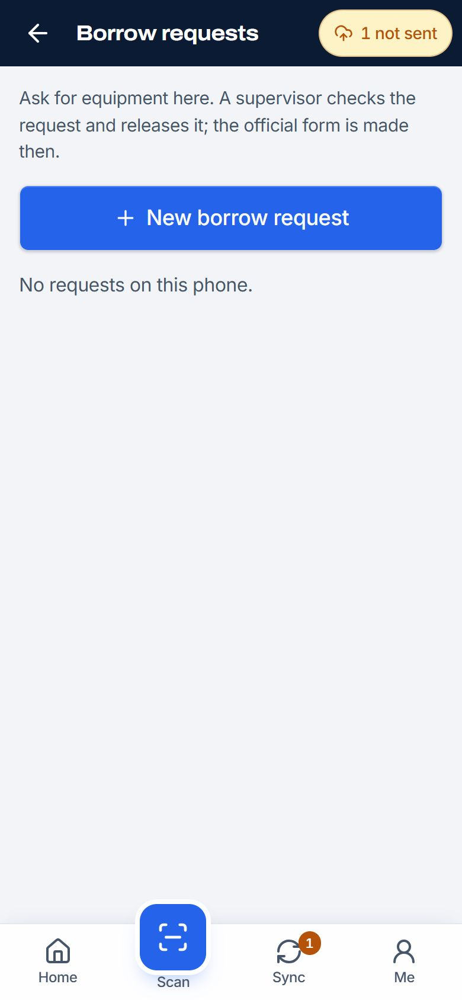

It's only a request. A supervisor checks it and does the official release.

## 30. Me

- **Appearance**: **Same as device**, **Light** or **Dark**.
- **Storage on this phone**: how much space IMS uses.
- **Install IMS on this phone**.
- **Sign out**. If you have counts that aren't sent, IMS warns you first. Signing out needs internet.

<!-- part: Quick reference -->

## 31. I want to…

| I want to…                      | Go to                                                       |
| ------------------------------- | ----------------------------------------------------------- |
| Add stock from a delivery       | **Dashboard** → **Receive**                                 |
| Give stock to someone           | **Dashboard** → **Issue**                                   |
| Use something up (bond paper)   | Open the item → **Use**                                     |
| Move stock between locations    | **Dashboard** → **Transfer**                                |
| Add a new kind of item          | **Stock** → **Add item**                                    |
| Add many items                  | **Stock** → **Import CSV**                                  |
| Tag new equipment               | **Assets** → **Add assets**                                 |
| Lend equipment                  | **Borrowing** → **Borrow equipment**                        |
| Take equipment back             | **Borrowing** → open the loan → **Return equipment**        |
| Count a location                | **Counts** → **New count**                                  |
| Find an item, asset or location | Search box, or **Scan** → **Type code instead**             |
| Print labels                    | Item or asset → **Print label**                             |
| Reprint a form                  | **Documents**                                               |
| Get a spreadsheet               | **Reports** → **Download CSV**                              |
| Add a person                    | **Users** → **Add user**                                    |
| Count with my phone             | **Home** → **Download for offline use** → **Scan to count** |

## 32. What the colors mean

| Color     | Means                                          |
| --------- | ---------------------------------------------- |
| 🟢 Green  | OK · Available · Done · All sent               |
| 🟠 Orange | Low stock · Borrowed · Not sent yet            |
| 🔴 Red    | Out of stock · Overdue · Problem, needs action |
| ⚪ Grey   | Inactive · Retired · Draft                     |

Dark mode: tap the sun / moon button at the top, or **Me** → **Appearance**.

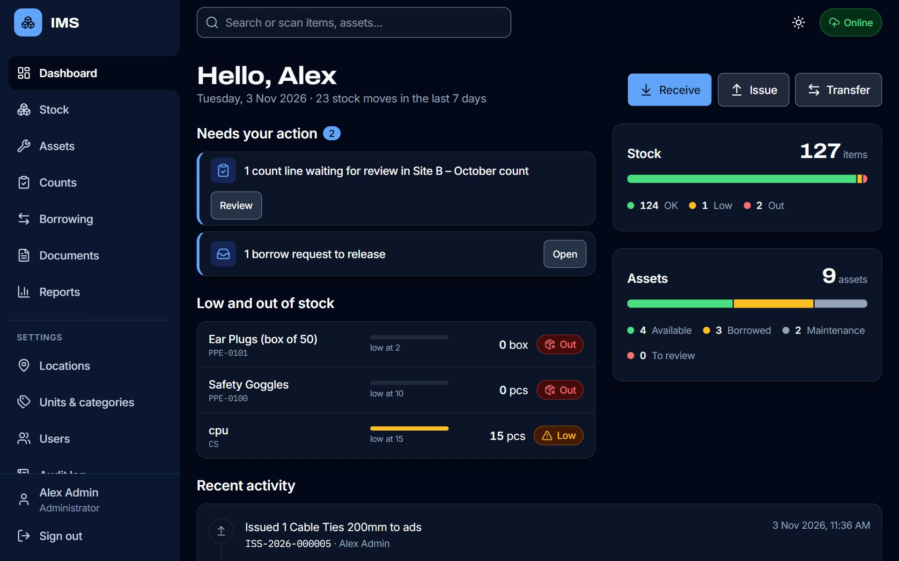

## 33. Problems

| Problem                                 | Do this                                                                                                                                                                                         |
| --------------------------------------- | ----------------------------------------------------------------------------------------------------------------------------------------------------------------------------------------------- |
| Added something by mistake              | Tick it in the list (**Stock**, **Assets**, **Locations** or **Users**) → **Delete selected**. Never-used records are deleted; used ones are hidden so their history stays. Assets are retired. |
| "Too many wrong attempts"               | Wait 15 minutes, or ask an administrator for a **Reset link**                                                                                                                                   |
| "… is counted stock, not an asset item" | That item is Stock. Make a new item with **How is it tracked?** = **Asset**                                                                                                                     |
| No **Add assets** button on an item     | The item is Stock. Use **Receive** for it, or make a new Asset item                                                                                                                             |
| "Only 3 left" when issuing              | Lower the quantity or pick another location                                                                                                                                                     |
| Stock moves are blocked at a location   | A count is open there. Finish it, or give a reason to move stock during the count                                                                                                               |
| Asset can't be borrowed                 | It's borrowed, under maintenance, lost or retired. Check its status on **Assets**                                                                                                               |
| "PDF failed"                            | **Documents** → **Retry PDF**                                                                                                                                                                   |
| CSV rows are red                        | Read the reason on each row; often the unit or category doesn't exist yet                                                                                                                       |
| Labels don't line up                    | Print at **100% scale** on 3 × 8 (70 × 37 mm) A4 label paper                                                                                                                                    |
| Camera won't open                       | Allow the camera for IMS in the phone settings, or use **Type a code**                                                                                                                          |
| "Not downloaded"                        | Get internet, then **Download for offline use**                                                                                                                                                 |
| Counts stuck on "not sent"              | Get internet → **Sync** → **Sync now**                                                                                                                                                          |

## 34. Don't

- **Don't clear browser data or uninstall IMS** while counts are not sent. Unsent counts would be lost.
- **Don't share your account.** Everything you do is recorded under your name.
- **Don't go out of signal without downloading** your assignment first.

## 35. Words used in IMS

| Word                | Means                                                           |
| ------------------- | --------------------------------------------------------------- |
| **SKU**             | The item's unique code, like `PPE-0001`                         |
| **Asset tag**       | One piece of equipment's unique code, like `TOOL-0001`          |
| **Location**        | A warehouse, site, or rack / area inside one                    |
| **Receive**         | Stock coming in                                                 |
| **Issue**           | Stock going out, not coming back                                |
| **Transfer**        | Stock moving between two locations                              |
| **Borrow / Return** | Equipment going out and coming back                             |
| **Custodian**       | The person responsible for a piece of equipment                 |
| **Count**           | Checking what is really on the shelf against what IMS says      |
| **Adjustment**      | The change to stock when a count difference is approved (ADJ-…) |
| **Low-stock level** | When on-hand stock falls to this number, IMS shows it as Low    |
